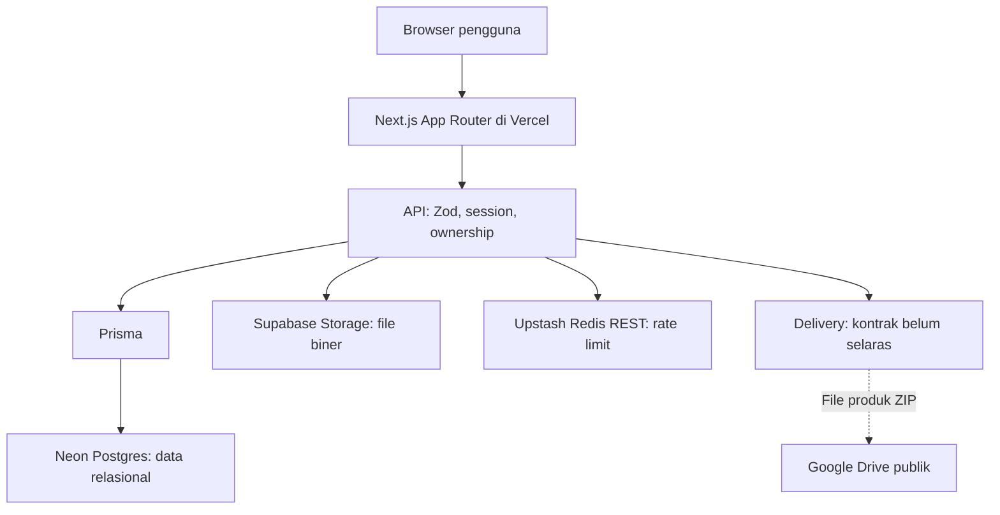
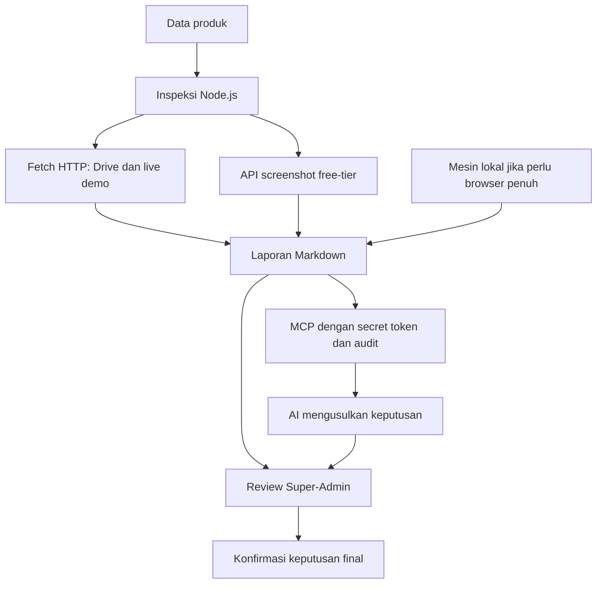

# ARCHITECTURE.md — Arsitektur Project Althentic.Dev

**Sumber keputusan:** `althentic-brainstorm-result-final.md`, bagian Konteks Terkunci dan 120 Q&A, ekspor 2026-10-27 09:49 WIB.
**Referensi silang:** `SPEC.md`; ID `SPEC-xx-yy` mengacu pada section `xx`, pertanyaan ke-`yy` di brainstorming.
**Status:** Dokumentasi arsitektur berdasarkan keputusan yang sudah tercatat. Kontrak implementasi yang belum diputuskan dan keputusan yang belum selaras ditandai secara eksplisit.

## 1. Aturan dan cakupan

1. Blok “Keputusan sumber” menyalin jawaban brainstorming atau butir Konteks Terkunci secara persis. Penanda “(Ketik sendiri)” dipertahankan dari sumber.
2. Tabel dan diagram memetakan hubungan keputusan tersebut. Pengelompokan kapabilitas bukan penetapan service, package, direktori, tabel database, atau deployment baru.
3. Dokumen ini tidak memilih library, provider, algoritme, kontrak API, atau pola infrastruktur yang belum ditentukan.
4. Jika dua keputusan belum selaras, keduanya tetap dicatat. Dokumen ini tidak menetapkan keputusan mana yang mengalahkan keputusan lainnya.
5. Lampiran teknis GradientASCII dan isometric block cluster tidak dipakai sebagai sumber arsitektur. Konfigurasi dan aset visualnya hanya dibahas dalam DESIGN.md.
6. Detail perilaku produk lengkap ada di SPEC.md. Diagram alur kerja lengkap disusun pada WORKFLOW.md sesuai urutan dokumen yang diminta.

## 2. Batas sistem dan deployment

**Keputusan sumber — Konteks Terkunci, butir 1**

> Althentic.Dev adalah marketplace PROMPT serbaguna dan multi-tenant (setiap seller punya toko dengan slug unik). Seller pertama adalah pemilik platform sendiri. Fokus awal menarik buyer.

**Keputusan sumber — Konteks Terkunci, butir 7**

> Tech stack final: Next.js App Router full-stack di Vercel saja, NeonDB Postgres, Neon + Supabase Storage, Nodemailer.

**Keputusan sumber — Konteks Terkunci, butir 3**

> Althentic tidak memegang uang. Seller memasang QR bisnisnya sendiri. Komisi Rp1.000 flat per transaksi terverifikasi, dicatat sebagai “Commission Owed”, dibayar seller secara threshold-based (invoice muncul otomatis saat mencapai threshold, lalu siklus reset ke nol). Bukti transfer komisi diverifikasi manual oleh Super-Admin tanpa AI. Toko bisa di-suspend jika menunggak.

### 2.1. Pemetaan komponen

| Komponen yang sudah dipilih             | Tanggung jawab berdasarkan sumber                                               | Referensi                                |
| --------------------------------------- | ------------------------------------------------------------------------------- | ---------------------------------------- |
| Next.js App Router full-stack di Vercel | Aplikasi web dan API platform.                                                  | Konteks Terkunci                         |
| NeonDB Postgres                         | Seluruh data relasional.                                                        | SPEC-15-01                               |
| Prisma                                  | ORM, schema-first, migration, dan type generation.                              | SPEC-15-02                               |
| Supabase Storage                        | File biner; bucket publik dan private terpisah.                                 | SPEC-15-01                               |
| Google Drive                            | File produk ZIP melalui link publik.                                            | Konteks Terkunci; SPEC-11-02             |
| Penyedia AI dengan BYOK seller          | Pemrosesan bukti pembayaran buyer; primary dan fallback key.                    | Konteks Terkunci; SPEC-07-08             |
| Upstash Redis REST                      | Sliding-window rate limit per-IP+user pada endpoint sensitif.                   | SPEC-15-03                               |
| Nodemailer                              | Email transaksi, penagihan, verifikasi, dan alert kritis.                       | Konteks Terkunci; SPEC-09-03; SPEC-15-05 |
| Skrip inspeksi Node.js                  | Pemeriksaan produk dan laporan Markdown.                                        | Konteks Terkunci; SPEC-08-01             |
| API screenshot free-tier                | Screenshot untuk inspeksi tanpa browser penuh di Vercel.                        | SPEC-15-07                               |
| MCP Streamable HTTP                     | Akses AI untuk membaca bahan verifikasi dan mengusulkan keputusan.              | Konteks Terkunci; SPEC-08-04–05          |
| GitHub Actions                          | `pg_dump` otomatis bulanan.                                                     | SPEC-15-06                               |
| Mesin lokal Super-Admin                 | Menjalankan skrip dengan browser penuh jika diperlukan lalu mengunggah laporan. | SPEC-15-07                               |

### 2.2. Diagram hubungan penyimpanan dan API

Diagram menunjukkan hubungan tanggung jawab, bukan urutan validasi yang baru. Jalur delivery diberi tanda belum selaras karena sumber menyebut download tanpa redirect sekaligus respons HTTP 302 ke Drive. Diagram tidak memilih proxy, streaming, atau redirect sebagai penyelesaian konflik.

### 2.3. Batas keputusan deployment

- Aplikasi full-stack tetap mengikuti keputusan Vercel saja. Penggunaan GitHub Actions untuk backup dan mesin lokal untuk inspeksi adalah keputusan eksplisit sumber.
- Jumlah project Vercel, region, versi runtime, struktur repository, struktur direktori, strategi preview/production, pipeline deploy, dan konfigurasi koneksi database: **[BELUM DIPUTUSKAN — perlu klarifikasi]**.
- Lokasi dan konfigurasi endpoint MCP dalam deployment Vercel, termasuk makna “tidak diekspos publik”: **[BELUM DIPUTUSKAN — perlu klarifikasi]**.
- Provider SMTP di balik Nodemailer dan provider API screenshot: **[BELUM DIPUTUSKAN — perlu klarifikasi]**.

## 3. Aktor, tenant, dan akses

**Keputusan sumber — SPEC-05-04**

> Satu akun = satu toko untuk fase awal; kebutuhan multi-toko ditunda sampai ada seller nyata yang memintanya.

**Keputusan sumber — SPEC-05-05**

> Semua akun otomatis berperan buyer; menjadi seller dilakukan lewat onboarding khusus (data toko + QR + API key semi-optional) tanpa approval manusia; kontrol kualitas dilakukan di verifikasi produk.

**Keputusan sumber — SPEC-02-01**

> Slug bersifat permanen dan tidak pernah bisa diubah setelah toko dibuat.

**Keputusan sumber — SPEC-06-04**

> Setelah memiliki minimal 1 produk berstatus terverifikasi (lolos inspeksi); sebelum itu toko berstatus “Disiapkan” yang hanya terlihat oleh pemiliknya.

**Keputusan sumber — Konteks Terkunci, butir 10**

> Dashboard Super-Admin yang sudah diputuskan: Overview lengkap (metrik ringkas + growth chart + kategori terlaris); single Super-Admin hardcoded; tabel seller (nama toko, slug, jumlah produk, commission owed, status, tanggal join, total transaksi terverifikasi, rating); list verifikasi produk berupa tabel + filter + search + audit trail di tab “Riwayat Verifikasi”; Dispute Resolution berupa inbox sederhana (Open/Investigating/Resolved), komunikasi di luar platform, refund manual di luar sistem.

**Keputusan sumber — SPEC-15-04**

> Validasi input dengan Zod di setiap route, cek session di dalam route (tidak percaya middleware semata), otorisasi per-ownership (buyer hanya menyentuh order miliknya), dan error response yang tidak membocorkan stack.

### 3.1. Pemetaan akses yang disebut sumber

| Aktor                        | Kapabilitas yang tercatat                                                                                    | Referensi                                      |
| ---------------------------- | ------------------------------------------------------------------------------------------------------------ | ---------------------------------------------- |
| Pengunjung                   | Melihat katalog; mencoba Prompt Generator tanpa login dengan ekspor terbatas.                                | SPEC-05-02; SPEC-12-01                         |
| Buyer                        | Checkout dengan akun, mengelola order sendiri, mengakses koleksi, menulis review sesuai syarat pembelian.    | SPEC-04-01; SPEC-15-04; SPEC-11-06; SPEC-10-05 |
| Seller                       | Onboarding tanpa approval manusia, satu toko, pengelolaan produk, order manual, BYOK, dan tagihan komisi.    | SPEC-05-04–05; section 2, 6, 7, 9              |
| Single Super-Admin hardcoded | Verifikasi produk, seller, komisi, analytics, moderasi, dan mediasi dispute.                                 | Konteks Terkunci                               |
| AI melalui MCP               | Membaca laporan/data produk dan mengusulkan approve/reject; keputusan final menunggu konfirmasi Super-Admin. | SPEC-08-05                                     |

### 3.2. Detail isolasi yang belum diputuskan

- Sumber menetapkan multi-tenant melalui toko berslug unik serta otorisasi per-ownership. Bentuk `tenantId`/foreign key, RLS, pemisahan schema, dan teknik isolasi query: **[BELUM DIPUTUSKAN — perlu klarifikasi]**.
- Identitas hardcoded Super-Admin dan bentuk penyimpanan/perhitungan peran: **[BELUM DIPUTUSKAN — perlu klarifikasi]**.
- Matriks izin lengkap untuk seluruh operasi seller dan Super-Admin: **[BELUM DIPUTUSKAN — perlu klarifikasi]**. Tabel di atas tidak memberi izin tambahan.
- Batas akses data transaksi perlu diselaraskan dengan klausul “hanya Super-Admin”; lihat bagian 14.

## 4. Kapabilitas aplikasi dan permukaan akses

Nama kelompok di bawah hanya pengelompokan dokumentasi. Sumber belum menentukan struktur modul kode selain kebutuhan interface tunggal delivery dan AI scanner.

| Kelompok kapabilitas           | Cakupan sumber                                                                                | Rujukan                         |
| ------------------------------ | --------------------------------------------------------------------------------------------- | ------------------------------- |
| Auth dan akun                  | Email/password, Google, verifikasi email, reset password, session, settings, soft-delete.     | Section 5                       |
| Toko dan onboarding            | Profil toko, slug permanen, QR, BYOK semi-optional, draft onboarding, produk pertama.         | Section 2 dan 6                 |
| Katalog dan produk             | Filter URL, pencarian, sorting, pagination, detail produk, arsip, perubahan harga.            | Section 2 dan 3                 |
| Checkout dan verifikasi bukti  | Order, QR seller, upload bukti, scanner, jalur manual dan WhatsApp.                           | Section 4 dan 7                 |
| Inspeksi dan verifikasi produk | Inspeksi Node.js, laporan, review Super-Admin, usulan AI lewat MCP, audit trail.              | Section 8                       |
| Komisi dan invoice             | Commission Owed, ledger per event, threshold, penagihan, pembayaran komisi manual.            | Section 1 dan 9                 |
| Delivery dan koleksi           | Akses file setelah Lunas, satu kali download, re-inspeksi, perubahan link.                    | Section 11                      |
| Trust & Safety                 | Laporan produk, review, takedown, dispute, sanksi, self-buy dan deteksi plagiarisme internal. | Section 10 dan 16               |
| Prompt Generator               | Tujuh blok, reorder, ekspor, template marketplace.                                            | Section 12                      |
| Analytics dan notifikasi       | Metrik platform/toko, CSV, email, notification center.                                        | Section 1, 2, 4, 13             |
| Halaman informasi              | Landing, dokumentasi, profil toko, status, 404/500, legal.                                    | Konteks Terkunci; section 13–14 |

### 4.1. URL dan path yang sudah disebut

| Bentuk literal dari sumber            | Fungsi                                                    | Batas keputusan                                                |
| ------------------------------------- | --------------------------------------------------------- | -------------------------------------------------------------- |
| `/toko/{slug}`                        | Profil publik toko.                                       | SPEC-13-01.                                                    |
| `/status`                             | Status sederhana Neon, Supabase Storage, endpoint kritis. | SPEC-13-05.                                                    |
| `/api/download/[orderId]`             | Akses download dengan session dan status Lunas.           | SPEC-11-02; perilaku redirect belum selaras dengan SPEC-04-05. |
| `receipts/{orderId}/{timestamp}.webp` | Path bukti lolos dalam bucket private.                    | SPEC-07-06; ini path storage, bukan route halaman.             |
| `uc?export=download&id=`              | Bentuk direct download Google Drive.                      | Konteks Terkunci.                                              |

URL halaman lain, metode HTTP, request/response body, skema error, nama query parameter, dan URL MCP: **[BELUM DIPUTUSKAN — perlu klarifikasi]**.

### 4.2. Perilaku katalog yang memengaruhi akses data

**Keputusan sumber — SPEC-03-02**

> Filter Kategori, Tipe Jual (Template Jadi / Prompt saja / Bundle), Rentang Harga (chip preset), dan Rating Minimum — semuanya tersimpan sebagai URL query sehingga hasil filter bisa di-share dan tombol back browser berfungsi.

**Keputusan sumber — SPEC-03-03**

> Default “Terlaris minggu ini”, dengan opsi: Terbaru, Termurah, Termahal, Rating tertinggi.

**Keputusan sumber — SPEC-03-04**

> Mencari di judul produk, deskripsi, dan nama toko; debounce 300ms; state “tidak ada hasil” menampilkan 3 chip kategori populer sebagai saran.

**Keputusan sumber — SPEC-03-05**

> Pagination klasik 24 produk per halaman dengan nomor halaman dan URL yang ikut berganti.

Teknik indeks pencarian, query SQL, cache, strategi rendering, dan invalidasi data katalog: **[BELUM DIPUTUSKAN — perlu klarifikasi]**. Debounce dan pagination yang sudah dipilih tidak menetapkan teknologi pencarian baru.

## 5. Arsitektur data dan penyimpanan

**Keputusan sumber — SPEC-15-01**

> Neon menyimpan semua data relasional (users, products, orders, ledger komisi, metadata bukti); Supabase Storage hanya menyimpan file biner (bukti .webp, banner, preview) dalam bucket publik dan private terpisah.

**Keputusan sumber — SPEC-15-02**

> Prisma: schema-first, migration tool matang, type generation kuat, dan dokumentasi melimpah — cocok untuk pengembang solo yang harus cepat jalan dengan aman.

**Keputusan sumber — SPEC-07-06**

> Supabase Storage bucket private dengan path receipts/{orderId}/{timestamp}.webp; akses hanya lewat signed URL berumur pendek yang diterbitkan API.

### 5.1. Pemisahan data yang tercatat

| Data                                                                             | Penempatan yang sudah ditetapkan                                                                                    | Referensi        |
| -------------------------------------------------------------------------------- | ------------------------------------------------------------------------------------------------------------------- | ---------------- |
| Data relasional, termasuk users, products, orders, ledger komisi, metadata bukti | Neon Postgres.                                                                                                      | SPEC-15-01       |
| Bukti lolos berbentuk WebP                                                       | Supabase Storage bucket private; akses signed URL dari API.                                                         | SPEC-07-06       |
| Banner dan preview                                                               | File biner di Supabase Storage; pembagian bucket per aset belum dirinci.                                            | SPEC-15-01       |
| File produk ZIP                                                                  | Google Drive dengan link publik.                                                                                    | Konteks Terkunci |
| File backup bulanan                                                              | Storage pribadi; penyedianya belum dipilih.                                                                         | SPEC-15-06       |
| API key BYOK                                                                     | Enkripsi at-rest AES-256-GCM dengan key dari environment Vercel; lokasi/kolom penyimpanan ciphertext belum dirinci. | SPEC-07-08       |
| Laporan inspeksi Markdown dan screenshot inspeksi                                | Bentuk hasil sudah ditentukan; lokasi penyimpanannya belum dirinci.                                                 | SPEC-08-01       |
| Gambar QR seller                                                                 | Upload sudah ditentukan; bucket, path, dan aturan aksesnya belum dirinci.                                           | SPEC-06-02       |

### 5.2. Inventaris informasi yang harus ditopang

Tabel ini memetakan kebutuhan informasi eksplisit; bukan schema Prisma atau daftar tabel fisik final.

| Area informasi       | Informasi yang disebut sumber                                                                                          | Referensi                                |
| -------------------- | ---------------------------------------------------------------------------------------------------------------------- | ---------------------------------------- |
| Akun                 | Email, nama, password/login Google, verifikasi, session, token reset ter-hash, preferensi, soft-delete.                | Section 5                                |
| Persetujuan          | Versi ToS/Privacy Policy dan tanggal persetujuan per akun; pernyataan usia.                                            | SPEC-14-03, SPEC-14-05                   |
| Toko                 | Pemilik, nama, slug, deskripsi, banner, aksen, link sosial, WA, QR, status dan data BYOK.                              | Section 2, 4, 6, 7                       |
| Produk               | Judul, deskripsi, kategori, preview, tipe jual/harga, Drive ZIP, live demo sesuai tipe, ukuran/isi file, hash, status. | Konteks Terkunci; section 2, 3, 8, 11    |
| Order                | ID, buyer/produk, tipe yang dipilih, harga terkunci, snapshot komisi, status dan timestamp perubahan.                  | SPEC-02-10; SPEC-04-05; SPEC-01-05       |
| Bukti pembayaran     | Hubungan dengan order, metadata, perceptual hash, file hash, dan file bukti lolos.                                     | SPEC-07-04, SPEC-07-06–07; SPEC-15-01    |
| Komisi dan invoice   | Ledger per event, Commission Owed, invoice, nominal diterima, tanggal bayar, metode, referensi opsional.               | SPEC-09-05–06                            |
| Audit verifikasi     | Aktor, timestamp, payload ringkas produk/laporan, hasil keputusan dan alasan.                                          | SPEC-08-06                               |
| Moderasi dan dispute | Laporan, alasan takedown, status inbox, bukti klarifikasi seller, alasan penghapusan review.                           | Konteks Terkunci; section 10; SPEC-16-02 |
| Review               | Hubungan pembelian, rating, teks, edit dalam 7 hari, satu balasan seller.                                              | SPEC-10-05–06                            |
| Notifikasi           | Objek terkait dan penanda belum-baca.                                                                                  | SPEC-13-02                               |
| Akses download       | Log setiap akses; pembatasan satu kali.                                                                                | SPEC-11-02–03                            |

Tipe kolom, enum database, unique constraint, index, foreign key, cascade, schema version, timezone penyimpanan, dan struktur migrasi: **[BELUM DIPUTUSKAN — perlu klarifikasi]**.

### 5.3. Nilai historis dan pencatatan komisi

**Keputusan sumber — SPEC-02-10**

> Harga baru hanya berlaku untuk order yang dibuat setelahnya; order berstatus Menunggu Verifikasi atau Booked tetap mengunci harga lama di baris ordernya.

**Keputusan sumber — SPEC-01-05**

> Field “Nominal komisi per transaksi” bisa diedit dari Settings, hanya berlaku untuk transaksi baru; setiap baris order menyimpan snapshot nominal komisi saat transaksi terjadi sehingga “Commission Owed” lama tidak berubah sendiri.

**Keputusan sumber — SPEC-09-05**

> Order batal/kedaluwarsa tidak pernah masuk “Commission Owed”; komisi hanya dicatat saat transaksi terverifikasi, dalam ledger terpisah per event.

Batas transaksi database untuk perubahan status dan pencatatan ledger, pencegahan pencatatan ganda, idempotensi, konkurensi verifikasi, serta penghitungan kuota download atomik: **[BELUM DIPUTUSKAN — perlu klarifikasi]**. Kebutuhan tersebut tidak dianggap sebagai keputusan desain yang sudah dibuat.

## 6. Auth, session, dan keamanan API

**Keputusan sumber — SPEC-05-01**

> Email + password sebagai jalur utama, dengan tombol “Lanjutkan dengan Google” sebagai alternatif yang setara.

**Keputusan sumber — SPEC-05-02**

> Wajib verifikasi sebelum checkout pertama, bukan sebelum bisa melihat-lihat katalog; link verifikasi kedaluwarsa dalam 24 jam dan bisa dikirim ulang.

**Keputusan sumber — SPEC-05-03**

> Email berisi link reset sekali-pakai yang kedaluwarsa dalam 1 jam; token disimpan ter-hash di database; setelah reset, semua session lama diturunkan.

**Keputusan sumber — SPEC-05-06**

> Ubah nama, ganti password, ganti email (wajib re-verifikasi), preferensi email notifikasi, dan hapus akun (soft-delete dengan masa tenggang 30 hari).

**Keputusan sumber — SPEC-05-07**

> 30 hari dengan opsi “Ingat saya di perangkat ini” dicentang; tanpa itu 1 hari; logout manual selalu tersedia.

**Keputusan sumber — SPEC-15-03**

> Rate limit berbasis Upstash Redis REST (free tier) dengan sliding window per-IP+user pada endpoint sensitif: login, upload bukti, dan submit order.

Validasi Zod, pemeriksaan session di dalam route, ownership, dan error tanpa stack mengikuti kutipan SPEC-15-04 pada bagian 3.

Library auth, format session, penyimpanan session, algoritme hash password, mekanisme OAuth Google, account linking, proteksi CSRF, dan nilai numerik sliding window: **[BELUM DIPUTUSKAN — perlu klarifikasi]**. Dokumen tidak menetapkan Auth.js, Supabase Auth, JWT, atau library lain sebagai pilihan final.

## 7. Order dan AI Receipt Scanner

**Keputusan sumber — Konteks Terkunci, butir 4**

> Verifikasi pembayaran buyer: AI Receipt Scanner dengan BYOK (Gemini dkk). Primary + Fallback key, semi-optional saat onboarding. Kurang bayar ditolak otomatis dan buyer upload bukti susulan. Jika kedua key gagal, muncul tombol WhatsApp ke seller dan produk berstatus “Booked”. Jika seller melewati setup API key, semua order disetujui manual. Bukti yang lolos dikonversi ke .webp sebelum masuk database.

**Keputusan sumber — SPEC-04-01**

> Wajib punya akun (email + password atau Google) sebelum masuk halaman checkout; registrasi bisa diselesaikan dari halaman produk tanpa kehilangan konteks.

**Keputusan sumber — SPEC-04-04**

> Satu gambar per percobaan, format JPG/PNG/HEIC maksimal 5 MB, wajib melalui layar preview sebelum submit, ditolak di sisi client jika bukan gambar valid.

**Keputusan sumber — SPEC-04-05**

> (Ketik sendiri) Enam status: Menunggu Pembayaran → Menunggu Verifikasi → Booked (jalur manual) → Lunas (file terbuka) → Dibatalkan → Kedaluwarsa, ditampilkan sebagai timeline stepper dengan timestamp tiap perubahan. seperti yang sudah saya bilang, jangan pernah menampilkan link google drive nya. jadi, link tersebut berada didalam button yang mana button tersebut ketika diklik, file .zip nya akan terdownload tanpa redirect ke google drive

**Keputusan sumber — SPEC-07-01**

> (Ketik sendiri) nominal di bukti harus persis sama; kurang dari itu ditolak otomatis sebagai kurang bayar, lebih dari itu ditandai untuk review manual dan menghubungi seller untuk melaporkan.

**Keputusan sumber — SPEC-07-02**

> Bukti harus dibuat dalam jendela sesi order: sejak buyer menekan “Bayar Sekarang” hingga batas kedaluwarsa order; timestamp lebih lama dari itu ditolak.

**Keputusan sumber — SPEC-07-03**

> Nama pengirim dibaca AI dan ditampilkan sebagai informasi pendukung di UI, tapi bukan syarat lolos-gagal yang keras.

**Keputusan sumber — SPEC-07-04**

> Setiap bukti yang lolos disimpan perceptual hash + file hash-nya; bukti baru yang hash-nya cocok dengan riwayat ditolak otomatis dengan alasan “bukti duplikat”.

**Keputusan sumber — SPEC-07-05**

> Dua lapis: AI diminta menilai indikasi manipulasi (font tidak konsisten, artefak edit, metadata), dan cross-check logika nominal-format; hasil “curiga” masuk antrian review manual dengan area yang dicurigai ditandai.

**Keputusan sumber — SPEC-07-08**

> Dienkripsi at-rest dengan AES-256-GCM memakai key dari environment Vercel, divalidasi dengan satu panggilan test murah saat disimpan, dan hanya pernah ditampilkan ter-mask (mis. AIza...9f2c) setelahnya.

**Keputusan sumber — SPEC-07-09**

> Seller bisa menekan “Ganti key” kapan saja di Settings toko; key lama langsung nonaktif; jika key gagal 3 kali berturut-turut, sistem mengirim email pengingat untuk rotasi.

**Keputusan sumber — SPEC-07-10**

> Order masuk antrian “Perlu Tindakan” di dashboard seller, buyer menerima email berisi instruksi kontak WA beserta ID order, dan status Booked memegang lock produk maksimal 24 jam.

**Keputusan sumber — SPEC-06-03**

> Lewati diperbolehkan dengan konsekuensi yang ditulis eksplisit di layar (“Semua order harus Anda approve manual”), dan langkah ini bisa diisi belakangan di Settings toko.

**Keputusan sumber — SPEC-02-06**

> Checklist 3 item wajib dicentang: nominal terlihat sesuai, nama/nomor pengirim terbaca di bukti, dan waktu transfer masuk akal dengan rentang order.

**Keputusan sumber — SPEC-02-07**

> 24 jam tanpa respons: order otomatis batal, buyer menerima email penjelasan dan boleh reorder, seller menerima peringatan kinerja pertama.

**Keputusan sumber — SPEC-04-08**

> Selama status masih “Menunggu Pembayaran” atau “Menunggu Verifikasi”, buyer bisa batalkan sendiri satu klik; setelah Lunas, hanya lewat jalur dispute.

### 7.1. Pemisahan jalur verifikasi

| Jalur yang disebut sumber          | Pelaksana/keputusan                                                                                                                 | Batas arsitektur                                                                                |
| ---------------------------------- | ----------------------------------------------------------------------------------------------------------------------------------- | ----------------------------------------------------------------------------------------------- |
| Seller memasang key                | AI Receipt Scanner dengan primary dan fallback; aturan nominal, waktu, duplikat, dan indikasi manipulasi mengikuti kutipan di atas. | Definisi respons provider, timeout, retry, dan urutan evaluasi seluruh aturan belum diputuskan. |
| Seller melewati key                | Semua order harus di-approve manual; checklist seller wajib.                                                                        | Tidak mengganti jalur ini dengan auto-approve.                                                  |
| Kedua key gagal                    | Antrian Perlu Tindakan, WhatsApp, email buyer, Booked.                                                                              | Makna lock dan Booked belum selaras; lihat bagian 14.                                           |
| Nominal lebih atau bukti dicurigai | Review manual sesuai aturan sumber.                                                                                                 | Seluruh transisi status untuk cabang ini belum diputuskan.                                      |
| Pembayaran komisi seller           | Verifikasi manual Super-Admin tanpa AI.                                                                                             | Ini terpisah dari scanner bukti pembayaran buyer.                                               |

### 7.2. Batas informasi scanner

- Sumber menyebut Gemini dan penyedia lain melalui BYOK; daftar provider/model final, apakah primary/fallback dapat lintas provider, dan kontrak input/output scanner: **[BELUM DIPUTUSKAN — perlu klarifikasi]**.
- Algoritme hash, ambang perceptual hash, ruang lingkup pencocokan duplikat, library konversi HEIC/WebP, dan aturan penyimpanan bukti sebelum lolos: **[BELUM DIPUTUSKAN — perlu klarifikasi]**.
- Mekanisme penggabungan bukti susulan kurang bayar dengan aturan nominal harus persis sama: **[BELUM DIPUTUSKAN — perlu klarifikasi]**.
- Batas kedaluwarsa sesi pembayaran biasa, titik mulai tenggat manual, dan state machine final: **[BELUM DIPUTUSKAN — perlu klarifikasi]**. Urutan status dalam sumber tidak dijadikan transisi otomatis dari Lunas ke Dibatalkan lalu Kedaluwarsa.

## 8. Inspeksi produk dan MCP

**Keputusan sumber — Konteks Terkunci, butir 5**

> Verifikasi produk: skrip inspeksi Node.js (cek link Drive, status HTTP live demo, screenshot) menghasilkan laporan Markdown. Super-Admin memverifikasi secara manual ATAU lewat AI via MCP server (Streamable HTTP). Notifikasi email ke Super-Admin lewat Nodemailer.

**Keputusan sumber — SPEC-15-07**

> Jangan jalankan browser penuh di Vercel: cek status link via fetch HTTP biasa, screenshot via API screenshot free-tier, dan bila perlu browser penuh, jalankan skrip dari mesin lokal Super-Admin lalu unggah laporannya.

**Keputusan sumber — SPEC-08-01**

> Struktur tetap: status link Drive (OK / 404 / private), status HTTP live demo + screenshot desktop, ukuran file .zip, hash file, dan timestamp inspeksi.

**Keputusan sumber — SPEC-08-02**

> Link Drive mati (404 atau private) ATAU live demo merespons HTTP 500 ke atas: langsung direject dengan email alasan ke seller dan tombol “Perbaiki & Kirim Ulang”.

**Keputusan sumber — SPEC-08-03**

> 14 hari sebelum produk otomatis masuk arsip, dengan email pengingat otomatis di hari ke-7.

**Keputusan sumber — SPEC-08-04**

> Endpoint MCP hanya menerima request dengan secret token dari environment, tidak diekspos publik, dan setiap pemanggilan tercatat di log audit.

**Keputusan sumber — SPEC-08-05**

> AI boleh membaca laporan inspeksi dan data produk, lalu mengusulkan keputusan (approve/reject beserta alasan); eksekusi final tetap menunggu satu klik konfirmasi Super-Admin.

**Keputusan sumber — SPEC-08-06**

> Setiap aksi tercatat: aktor (sistem otomatis / Super-Admin / AI), timestamp, payload ringkas (produk, laporan), dan hasil keputusan beserta alasannya.

**Keputusan sumber — SPEC-10-01**

> Dua lapis: verifikasi teknis otomatis (link Drive, live demo) lewat skrip inspeksi, ditambah review singkat Super-Admin atas deskripsi, preview, dan harga untuk menangkap konten ilegal atau menyesatkan.

**Keputusan sumber — SPEC-16-09**

> Tidak ada penilaian kualitas; semua prompt yang link-nya hidup boleh dijual.

### 8.1. Hubungan komponen inspeksi

Diagram ini memperlihatkan jalur review laporan. Reject otomatis karena Drive 404/private atau HTTP live demo 500 ke atas tetap mengikuti SPEC-08-02 dan tidak diwajibkan menunggu klik Super-Admin. Usulan AI tidak mengeksekusi keputusan final sendiri.

Live demo wajib hanya untuk tipe yang menyertakan template jadi, sesuai Konteks Terkunci. Detail laporan untuk tipe tanpa live demo, penanganan HTTP selain kondisi reject eksplisit, lokasi laporan, daftar tool MCP, payload, transport configuration, dan kebijakan jaringan endpoint: **[BELUM DIPUTUSKAN — perlu klarifikasi]**.

Moderasi konten ilegal/menyesatkan dan pernyataan tidak ada penilaian kualitas sama-sama dipertahankan. Penyelarasan syarat publikasi dicatat pada bagian 14.

## 9. Komisi, penagihan, dan suspend

**Keputusan sumber — SPEC-16-05**

> Tetap Rp1.000 flat tanpa pengecualian harga.

**Keputusan sumber — SPEC-09-04**

> Rp25.000 (setara 25 transaksi terverifikasi), dapat diubah Super-Admin di Settings.

**Keputusan sumber — SPEC-09-06**

> Form verifikasi berisi: pilih invoice, nominal diterima, tanggal bayar, metode (transfer/e-wallet), dan referensi opsional; setelah disimpan status invoice menjadi Lunas dan counter reset ke nol.

**Keputusan sumber — SPEC-01-06**

> Setting “Batas tunggakan sebelum suspend” default Rp25.000 (setara 25 transaksi); saat terlewati toko di-suspend otomatis, dengan email peringatan otomatis saat saldo menyentuh 50% dan 80% dari batas.

**Keputusan sumber — SPEC-09-02**

> 7 hari setelah invoice terbit: email reminder di hari ke-1, ke-3, dan ke-5; suspend otomatis di hari ke-8 bila belum dibayar.

**Keputusan sumber — SPEC-09-03**

> Email otomatis (Nodemailer) berisi jumlah tunggakan, cara bayar, batas tanggal suspend, ditambah banner kuning di dashboard seller saat tersisa 3 hari sebelum suspend.

**Keputusan sumber — SPEC-09-01**

> Produk disembunyikan dari katalog; order berstatus Lunas tetap bisa mengakses filenya; order Menunggu Verifikasi/Booked diberi tenggat 24 jam untuk diselesaikan manual oleh seller.

### 9.1. Batas tanggung jawab keuangan

- Althentic tidak memegang uang; buyer memakai QR bisnis seller. Pembayaran komisi diverifikasi Super-Admin secara manual tanpa AI, sesuai Konteks Terkunci.
- Snapshot komisi dan ledger per event mengikuti bagian 5.3.
- Invoice threshold dan batas tunggakan sebelum suspend sama-sama memiliki default Rp25.000 pada sumber. Dokumen tidak menggabungkan keduanya menjadi satu setting baru.
- Waktu reset siklus/counter dan suspend masih memerlukan penyelarasan. Tidak ada penetapan otomatis bahwa invoice terbit sekaligus menghapus kewajiban lama.
- Rekonsiliasi transaksi baru saat invoice aktif, pembayaran komisi kurang/lebih, dampak refund pada komisi, alur prompt gratis, dan unsuspend setelah pembayaran: **[BELUM DIPUTUSKAN — perlu klarifikasi]**.

## 10. Delivery, koleksi, dan abstraksi provider

**Keputusan sumber — Konteks Terkunci, butir 2**

> Produk berupa file .zip di Google Drive (link publik, direct download via `uc?export=download&id=`). Preview gambar wajib. Kategori Website punya 3 tipe jual (Template Jadi / Prompt saja / Bundle) dengan harga terpisah. Live demo wajib hanya untuk tipe yang menyertakan template jadi.

**Keputusan sumber — SPEC-11-01**

> Re-inspeksi berkala mingguan untuk semua produk aktif; saat link mati, produk otomatis di-unlist, seller diberi tenggat 72 jam untuk memperbaiki sebelum listing disuspend.

**Keputusan sumber — SPEC-11-02**

> Link Drive tidak pernah tampil mentah; buyer mengakses via endpoint redirect /api/download/[orderId] yang memvalidasi session dan status Lunas, baru 302 ke link Drive; setiap akses tercatat di log.

**Keputusan sumber — SPEC-11-03**

> Hanya 1 kali download, tanpa kecuali dan tanpa reset.

**Keputusan sumber — SPEC-11-04**

> File lama langsung ditimpa tanpa notifikasi ke buyer yang sudah membeli.

**Keputusan sumber — SPEC-11-05**

> Penggantian link memicu verifikasi ulang singkat (cek link baru hidup dan publik) sebelum produk aktif kembali; hash file dihitung ulang untuk mendeteksi perubahan isi.

**Keputusan sumber — SPEC-11-06**

> Halaman “Koleksi Saya” permanen di akun buyer: semua order Lunas dengan tombol download, info versi, dan tanggal beli.

**Keputusan sumber — SPEC-16-04**

> Dokumentasikan abstraksi: modul delivery dan modul AI scanner masing-masing punya satu interface tunggal sehingga bisa ganti provider dengan menyentuh 1–2 file saja; digunakan saat benar-benar dibutuhkan.

### 10.1. Kontrak yang sudah disebut dan batasnya

| Area             | Keputusan yang tersedia                                                                       | Rincian yang belum diputuskan                                                                         |
| ---------------- | --------------------------------------------------------------------------------------------- | ----------------------------------------------------------------------------------------------------- |
| Modul delivery   | Satu interface tunggal agar provider dapat diganti dengan menyentuh 1–2 file saat dibutuhkan. | Nama interface, signature, error model, metode delivery yang menyelaraskan tanpa redirect dengan 302. |
| Modul AI scanner | Satu interface tunggal agar provider dapat diganti dengan menyentuh 1–2 file saat dibutuhkan. | Schema request/response, mapping error, daftar provider dan retry.                                    |
| Hak download     | Session dan Lunas; ownership sesuai keamanan route; log akses; satu kali tanpa kecuali/reset. | Titik konsumsi kuota, download terputus, request paralel, tampilan setelah habis.                     |
| Update produk    | File lama ditimpa; link baru diperiksa lagi dan hash dihitung ulang.                          | Definisi info versi, snapshot file per order, dan kaitan dengan notification center.                  |

Seluruh rincian pada kolom terakhir berstatus **[BELUM DIPUTUSKAN — perlu klarifikasi]**. Dokumen tidak menulis interface TypeScript sebagai kontrak final yang belum ada di brainstorming.

Sumber menyebut link Drive publik dan endpoint akses platform. Klaim bahwa URL tersebut tidak dapat ditemukan atau dibagikan di luar platform tidak ditetapkan oleh sumber. Cakupan proteksi yang dimaksud perlu diselaraskan dengan keputusan 302 dan larangan redirect; **[BELUM DIPUTUSKAN — perlu klarifikasi]**.

## 11. Notifikasi, analytics, dan Prompt Generator

### 11.1. Kanal notifikasi

**Keputusan sumber — SPEC-04-06**

> Empat email: order dibuat (berisi instruksi bayar + QR), bukti diterima dan sedang diverifikasi, verifikasi berhasil (berisi akses file), verifikasi gagal (berisi alasan dan cara upload ulang).

**Keputusan sumber — SPEC-04-07**

> Email untuk semua event order, ditambah badge counter menonjol di dashboard seller untuk order yang menunggu aksi manual.

**Keputusan sumber — SPEC-04-03**

> Nomor WA diambil dari field wajib saat onboarding seller (divalidasi format Indonesia), dirender sebagai tombol “Hubungi via WhatsApp” dengan pesan template berisi ID order dan nama produk.

**Keputusan sumber — SPEC-01-07**

> Textarea template di Settings dengan placeholder {nama_buyer}, {nama_produk}, {jumlah}, {slug_toko}, plus tombol “Uji pratinjau” yang merender contoh pesan.

**Keputusan sumber — SPEC-13-02**

> Ikon lonceng dengan panel berisi: update order, hasil verifikasi produk, tagihan komisi/invoice, dan update produk yang dibeli — lengkap dengan penanda belum-baca dan link ke objek terkait.

**Keputusan sumber — SPEC-13-03**

> Tema tampilan (Dark/Light/System), bahasa email notifikasi (ID/EN), dan preferensi email promosi yang bisa dimatikan.

Notifikasi inspeksi ke Super-Admin menggunakan Nodemailer sesuai Konteks Terkunci. Email reminder komisi, rotasi key, produk ditolak, arsip, pembatalan manual, dan alert kritis mengikuti keputusan masing-masing bagian.

Provider SMTP, template lengkap, kebijakan retry email, penyimpanan log pengiriman, polling/push notification center, dan mekanisme realtime status verifikasi: **[BELUM DIPUTUSKAN — perlu klarifikasi]**. Kata “realtime” pada onboarding tidak menetapkan WebSocket atau layanan realtime tertentu.

### 11.2. Analytics dan ekspor

**Keputusan sumber — SPEC-01-01**

> “7 hari terakhir” sebagai periode default, dengan tab cepat: Hari ini / 7 hari / 30 hari / 90 hari / Custom.

**Keputusan sumber — SPEC-01-02**

> GMV estimasi (nilai transaksi terverifikasi), jumlah transaksi terverifikasi, komisi tertagih vs outstanding, dan rasio seller aktif vs suspend — satu layar langsung menjawab “sehat atau tidaknya marketplace”.

**Keputusan sumber — SPEC-01-03**

> Line chart harian tetap ditampilkan, ditambah garis kedua berupa moving average 7 hari sebagai baseline tren.

**Keputusan sumber — SPEC-01-04**

> Export CSV per-tabel (transaksi, komisi, seller) dengan semua filter aktif diterapkan ke file yang diunduh.

**Keputusan sumber — SPEC-02-08**

> Empat kartu: transaksi terverifikasi, revenue kotor, Commission Owed berjalan, dan produk terlaris — dilengkapi grafik 30 hari dan tabel 5 produk teratas.

**Keputusan sumber — SPEC-16-03**

> Tambahkan metrik “konsentrasi top-1 seller” di dashboard Super-Admin sebagai sinyal untuk mempercepat rekrutmen seller, tanpa pembatasan eksplisit terhadap seller produktif.

**Keputusan sumber — SPEC-16-12**

> Verifikasi transaksi mencocokkan sinyal: akun buyer dengan IP/device fingerprint yang sama dengan seller ditandai; transaksi self-buy tidak dihitung ke metrik terlaris dan ratingnya diflag untuk review.

**Keputusan sumber — SPEC-16-15**

> Jumlah transaksi terverifikasi per bulan.

Query agregasi, pembulatan nominal, zona waktu pengelompokan harian, cache, materialized view, dan formula lengkap metrik yang belum dirinci: **[BELUM DIPUTUSKAN — perlu klarifikasi]**. Tidak ada warehouse atau layanan analytics tambahan yang dipilih.

### 11.3. Prompt Generator

**Keputusan sumber — SPEC-12-01**

> Publik tanpa login untuk mencoba, dengan ekspor terbatas; akun terdaftar membuka ekspor penuh dan integrasi marketplace.

**Keputusan sumber — SPEC-12-02**

> Gratis penuh di fase awal sebagai alat akuisisi dan demo kualitas prompt; monetisasi nanti lewat template prompt premium di marketplace.

**Keputusan sumber — SPEC-12-03**

> Tujuh blok inti: Peran (Role), Tugas (Task), Konteks, Format Output, Batasan (Constraints), Contoh (Examples), dan Tone/Gaya.

**Keputusan sumber — SPEC-12-04**

> Kolom vertikal drag-and-reorder dengan drag handle per blok; urutan blok menentukan urutan struktur prompt akhir.

**Keputusan sumber — SPEC-12-05**

> Tiga format: Markdown terstruktur, plain text siap-tempel ke chat AI, dan JSON dengan tiap blok sebagai key.

**Keputusan sumber — SPEC-12-06**

> Tombol “Coba di Generator” di halaman detail produk tipe “Prompt saja”; struktur prompt terjual tampil sebagai template read-only di canvas, dengan isi tersembunyi sampai pembelian selesai.

Persistensi canvas, library drag-and-drop, batas ekspor guest, nama key JSON, serta sumber struktur template dari file ZIP: **[BELUM DIPUTUSKAN — perlu klarifikasi]**. Sumber tidak menetapkan pemanggilan LLM oleh Prompt Generator.

## 12. Otomasi, logging, backup, dan kegagalan

### 12.1. Kebutuhan eksekusi terjadwal

| Proses                     | Waktu/pemicu dari sumber                                                                                   | Referensi              |
| -------------------------- | ---------------------------------------------------------------------------------------------------------- | ---------------------- |
| Order manual tanpa respons | Otomatis batal setelah 24 jam; email buyer dan peringatan seller.                                          | SPEC-02-07             |
| Produk ditolak             | Pengingat hari ke-7; arsip otomatis setelah 14 hari.                                                       | SPEC-08-03             |
| Reminder invoice           | Hari ke-1, ke-3, ke-5; grace period 7 hari dan suspend hari ke-8, dengan konflik terhadap batas tunggakan. | SPEC-09-02; SPEC-01-06 |
| Peringatan saldo komisi    | Saat saldo menyentuh 50% dan 80% batas.                                                                    | SPEC-01-06             |
| Banner penagihan           | Saat tersisa 3 hari sebelum suspend.                                                                       | SPEC-09-03             |
| Re-inspeksi produk aktif   | Mingguan; link mati mendapat tenggat perbaikan 72 jam.                                                     | SPEC-11-01             |
| Penghapusan bukti lolos    | 30 hari menurut scanner; klausul privasi menyebut maksimal 90 hari.                                        | SPEC-07-07; SPEC-14-01 |
| Backup database            | `pg_dump` bulanan melalui GitHub Actions; uji restore berkala.                                             | SPEC-15-06             |

Tabel adalah daftar kebutuhan pemicu/waktu, bukan keputusan bahwa semua proses memakai scheduler yang sama. Scheduler selain backup bulanan, frekuensi polling, identitas job, timezone, retry, pencegahan eksekusi ganda, dan pemulihan job gagal: **[BELUM DIPUTUSKAN — perlu klarifikasi]**.

### 12.2. Logging dan pemulihan

**Keputusan sumber — SPEC-15-05**

> Structured logging JSON konsisten dilihat lewat Vercel Logs, plus alert email via Nodemailer untuk error kritis (verifikasi gagal massal, koneksi DB gagal).

**Keputusan sumber — SPEC-15-06**

> Mengandalkan point-in-time restore bawaan Neon, ditambah pg_dump otomatis bulanan via GitHub Actions terjadwal yang disimpan di storage pribadi — dengan uji restore berkala.

**Keputusan sumber — SPEC-13-05**

> Ya, versi sederhana di /status: kesehatan Neon, Supabase Storage, dan endpoint kritis; diperbarui manual saat insiden ditambah halaman statis sehari-hari.

**Keputusan sumber — SPEC-16-13**

> Terima risiko platform berhenti total selama itu.

**Keputusan sumber — SPEC-16-14**

> Kandidat paling fatal: API key seller (menyalahgunakan kuota AI atas nama mereka) dan bukti transfer (data finansial); siapkan satu halaman SOP insiden: identifikasi → rotasi key → notifikasi terdampak → post-mortem.

### 12.3. Kegagalan dan respons yang sudah dipilih

| Kondisi                                       | Respons sumber                                                  | Batas informasi                                                 |
| --------------------------------------------- | --------------------------------------------------------------- | --------------------------------------------------------------- |
| Primary dan fallback AI gagal                 | Jalur seller/manual, WA, email, Booked.                         | Definisi lock belum selaras.                                    |
| Key gagal 3 kali berturut-turut               | Email pengingat rotasi.                                         | Definisi satu kegagalan dan reset penghitung belum dirinci.     |
| Drive mati saat inspeksi awal                 | Reject otomatis dan email alasan.                               | Rincian retry fetch belum diputuskan.                           |
| Drive mati setelah produk aktif               | Unlist, tenggat 72 jam, lalu listing disuspend.                 | Frekuensi re-inspeksi mingguan sudah dipilih.                   |
| Koneksi DB gagal atau verifikasi gagal massal | Alert email melalui Nodemailer dan structured logging.          | Threshold gagal massal belum ditentukan.                        |
| Super-Admin tidak tersedia                    | Risiko platform berhenti total diterima.                        | Tidak ditambahkan admin pengganti atau persetujuan AI otomatis. |
| Insiden data                                  | Identifikasi → rotasi key → notifikasi terdampak → post-mortem. | Isi rinci SOP belum tersedia.                                   |

### 12.4. Nonfungsional yang belum ditetapkan

SLA, SLO, latensi target, kapasitas transaksi, RPO/RTO, retensi log, anggaran operasional, limit biaya provider, jadwal uji restore, dan prosedur rollback deployment: **[BELUM DIPUTUSKAN — perlu klarifikasi]**. Pemakaian free tier Upstash dan API screenshot berasal dari sumber; tidak berarti seluruh operasi dijamin tanpa biaya.

## 13. Retensi, legal, dan moderasi

**Keputusan sumber — SPEC-07-07**

> (Ketik sendiri) 30 hari untuk kebutuhan dispute; setelah itu job terjadwal menghapus file fisiknya sementara metadata transaksi tetap di database.

**Keputusan sumber — SPEC-14-01**

> Klausul eksplisit: gambar bukti diproses oleh layanan AI pihak ketiga yang dipilih seller (memakai API key milik seller); data dikirim langsung ke penyedia tersebut; Althentic tidak menyimpan salinan hasil proses; gambar disimpan maksimal 90 hari lalu dihapus.

**Keputusan sumber — SPEC-14-02**

> Digolongkan sebagai “data transaksi”: disimpan selama akun aktif ditambah 5 tahun mengikuti kebiasaan pembukuan, dengan akses terbatas hanya Super-Admin.

**Keputusan sumber — SPEC-14-03**

> Checkbox wajib saat pendaftaran + banner re-consent saat ada perubahan material (menampilkan ringkasan perubahan); versi dokumen dan tanggal persetujuan dicatat per akun.

**Keputusan sumber — SPEC-14-04**

> Dinyatakan eksplisit: Althentic hanya menarik komisi layanan; seluruh kewajiban pajak atas penjualan menjadi tanggung jawab seller; platform menyediakan ringkasan transaksi tahunan untuk membantu pembukuan.

**Keputusan sumber — SPEC-14-05**

> Minimal 17 tahun, dinyatakan di ToS dan dikonfirmasi lewat checkbox pernyataan usia saat pendaftaran.

**Keputusan sumber — SPEC-14-06**

> Hukum Indonesia dengan domisili hukum di kota domisili pemilik platform; mediasi wajib sebelum litigasi; ToS ditulis dalam bahasa Indonesia dengan ringkasan bahasa Inggris yang tidak mengikat.

**Keputusan sumber — SPEC-10-02**

> Super-Admin bisa takedown kapan saja namun wajib mengisi alasan terstruktur; seller menerima email alasan tersebut dan bisa mengajukan banding lewat jalur dispute.

**Keputusan sumber — SPEC-10-03**

> Lima kategori tetap: Konten ilegal, Plagiarisme, Isi tidak sesuai deskripsi, Penipuan pembayaran, Lainnya — plus field detail opsional.

**Keputusan sumber — SPEC-10-04**

> Refund didukung bila: file tidak bisa diakses, isi berbeda drastis dari deskripsi, atau seller tidak merespons 48 jam; “tidak cocok selera” bukan dasar refund.

**Keputusan sumber — SPEC-10-05**

> Hanya buyer dengan order Lunas pada produk tersebut, satu review per pembelian, berisi rating + teks, dan boleh diedit sendiri dalam 7 hari pertama.

**Keputusan sumber — SPEC-10-06**

> Seller tidak bisa menghapus review, hanya bisa membalas satu kali secara publik; review yang melanggar (hujatan, doxing, spam) hanya bisa dihapus Super-Admin dengan alasan tercatat.

**Keputusan sumber — SPEC-10-07**

> Empat tingkat eskalasi: peringatan email → suspend listing 7 hari → suspend toko sampai pelanggaran beres → banned permanen dengan pemblokiran email dan pola perangkat.

**Keputusan sumber — SPEC-16-01**

> Deteksi otomatis antar produk di katalog Althentic sendiri saja.

**Keputusan sumber — SPEC-16-02**

> Seller wajib menunjukkan bukti isi (screenshot terstruktur atau walkthrough singkat) dalam 48 jam lewat dispute; terbukti sesuai: tetap lunas dengan catatan; tidak sesuai: refund manual plus poin sanksi seller.

**Keputusan sumber — SPEC-16-10**

> ToS menyatakan: lisensi penggunaan personal dan komersial atas output, dilarang menjual ulang atau mendistribusikan file prompt mentah; pelanggaran berujung banned.

### 13.1. Batas implementasi

- File bukti dan metadata transaksi memiliki perlakuan berbeda: penghapusan file fisik setelah retensi scanner tidak menghapus metadata transaksi menurut SPEC-07-07.
- Klausul “Althentic tidak menyimpan salinan hasil proses” belum merinci pemisahan output AI, metadata verifikasi, dan informasi pendukung nama pengirim. Skema penyimpanan detailnya: **[BELUM DIPUTUSKAN — perlu klarifikasi]**.
- Retensi data transaksi dan soft-delete akun sama-sama berlaku sebagai keputusan sumber. Proses pasca-masa tenggang 30 hari, anonimisasi, serta data yang tetap tersedia untuk koleksi/dispute/komisi: **[BELUM DIPUTUSKAN — perlu klarifikasi]**.
- Mekanisme device fingerprint, pencocokan plagiarisme internal, dan hubungan poin sanksi dengan eskalasi: **[BELUM DIPUTUSKAN — perlu klarifikasi]**.
- Refund dan komunikasi dispute tetap di luar platform sesuai Konteks Terkunci. Tidak ada payment gateway, escrow, atau refund otomatis yang ditetapkan dokumen ini.

## 14. Konflik yang berdampak pada arsitektur

| Referensi SPEC.md                          | Keputusan yang harus sama-sama dipertahankan                                                                                  | Kontrak yang belum dapat ditetapkan                                                               |
| ------------------------------------------ | ----------------------------------------------------------------------------------------------------------------------------- | ------------------------------------------------------------------------------------------------- |
| GAP-01; SPEC-03-07, SPEC-04-02, SPEC-07-10 | Booked sebagai keranjang; pembelian paralel; lock produk maksimal 24 jam saat kedua key gagal.                                | Objek lock, relasi cart/order, waktu pelepasan dan state machine.                                 |
| GAP-02; SPEC-04-05, SPEC-11-02             | Download tanpa redirect ke Google Drive; endpoint melakukan 302 ke Drive.                                                     | Kontrak transport delivery final.                                                                 |
| GAP-03; SPEC-01-06, SPEC-09-02             | Suspend saat batas terlewati; suspend hari ke-8 setelah invoice.                                                              | Pemicu suspend dan urutan job penagihan.                                                          |
| GAP-04; SPEC-07-07, SPEC-14-01             | Penghapusan 30 hari; klausul maksimal 90 hari.                                                                                | Penyelarasan janji retensi dan kebijakan penghapusan, tanpa otomatis mengganti 30 dengan 90 hari. |
| GAP-05; SPEC-11-04, SPEC-13-02             | Update file tanpa notifikasi; notification center mencakup update produk dibeli.                                              | Event yang memicu notifikasi produk.                                                              |
| GAP-06; SPEC-14-02 dan fitur seller/buyer  | Akses data transaksi hanya Super-Admin; seller mengelola QR/transaksi, buyer menerima QR/instruksi.                           | Matriks akses per jenis data dan aktor.                                                           |
| GAP-07; SPEC-10-01, SPEC-16-09             | Review konten ilegal/menyesatkan; semua prompt dengan link hidup boleh dijual tanpa penilaian kualitas.                       | Penyelarasan syarat publikasi produk.                                                             |
| GAP-08; SPEC-06-01, SPEC-06-04, SPEC-06-06 | Pengiriman verifikasi pada langkah keempat; layar selesai meminta pengiriman pertama; toko live setelah produk terverifikasi. | Kondisi onboarding selesai, toko siap, dan toko live.                                             |
| GAP-09; Konteks Terkunci, SPEC-09-06       | Siklus reset setelah threshold/invoice dalam konteks; counter reset setelah pembayaran invoice diverifikasi.                  | Definisi counter/siklus dan transaksi baru saat invoice aktif.                                    |

Status seluruh baris: **[BELUM DIPUTUSKAN — perlu klarifikasi]**. Ini tidak membatalkan keputusan sumber; implementasi terkait belum boleh menganggap salah satu versi telah digantikan.

## 15. Catatan keputusan arsitektur (ADR)

ADR berikut mencatat keputusan sumber yang sudah ada, bukan persetujuan baru atas desain tambahan. Blok kutipan di bagian rujukan menjadi teks keputusan lengkap. Alternatif teknologi tidak dievaluasi ulang karena pengguna menetapkan brainstorming sebagai sumber keputusan tunggal.

| ADR                                       | Konteks dan keputusan tercatat                                                                              | Konsekuensi/batas yang tercatat                                                                                              | Rujukan                                       |
| ----------------------------------------- | ----------------------------------------------------------------------------------------------------------- | ---------------------------------------------------------------------------------------------------------------------------- | --------------------------------------------- |
| ADR-01 — Runtime                          | Aplikasi Next.js App Router full-stack di Vercel saja.                                                      | Browser penuh untuk inspeksi tidak dijalankan di Vercel.                                                                     | Bagian 2 dan 8; Konteks Terkunci; SPEC-15-07  |
| ADR-02 — Database dan file                | Neon untuk data relasional; Supabase Storage untuk file biner; Prisma sebagai ORM.                          | Alasan Prisma: schema-first, migration matang, type generation kuat, dokumentasi melimpah untuk pengembang solo.             | Bagian 5; SPEC-15-01–02                       |
| ADR-03 — Pembayaran                       | Uang buyer langsung melalui QR seller; komisi dicatat sebagai kewajiban.                                    | Pembayaran komisi diverifikasi manual Super-Admin tanpa AI; konflik siklus dan suspend belum diselesaikan.                   | Bagian 2 dan 9; Konteks Terkunci; section 9   |
| ADR-04 — AI Receipt Scanner               | BYOK primary/fallback, semi-optional; AES-256-GCM at-rest.                                                  | Skip key berarti semua order manual; kegagalan kedua key menuju tindakan seller.                                             | Bagian 7; SPEC-06-03; SPEC-07-08–10           |
| ADR-05 — Verifikasi produk                | Inspeksi Node.js, laporan Markdown, review manual atau usulan AI melalui MCP Streamable HTTP.               | AI hanya mengusulkan; keputusan final menunggu klik Super-Admin. Reject otomatis teknis tetap ada.                           | Bagian 8; SPEC-08-01–06                       |
| ADR-06 — Akses API                        | Zod, session di route, ownership, error tanpa stack; rate limit Upstash Redis REST.                         | Sliding window per-IP+user pada login, upload bukti, submit order.                                                           | Bagian 3 dan 6; SPEC-15-03–04                 |
| ADR-07 — Delivery dan pergantian provider | ZIP di Drive publik; satu interface delivery dan satu interface scanner.                                    | Tujuan pergantian provider menyentuh 1–2 file saat benar-benar dibutuhkan; kontrak delivery masih memiliki konflik redirect. | Bagian 10; SPEC-11-02–03; SPEC-16-04          |
| ADR-08 — Operasional                      | JSON log di Vercel Logs, Nodemailer untuk alert, PITR Neon dan backup `pg_dump` bulanan via GitHub Actions. | Storage pribadi dan uji restore berkala; detail RPO/RTO belum diputuskan.                                                    | Bagian 12; SPEC-15-05–06                      |
| ADR-09 — Single Super-Admin               | Single Super-Admin hardcoded.                                                                               | Risiko platform berhenti total saat Super-Admin tidak tersedia diterima.                                                     | Bagian 3 dan 12; Konteks Terkunci; SPEC-16-13 |

Status ADR: **tercatat dalam brainstorming**. Analisis alternatif, estimasi biaya, serta trade-off tambahan yang tidak dicatat sumber: **[BELUM DIPUTUSKAN — perlu klarifikasi]**. Catatan batas/conflict pada ADR tidak menyelesaikan gap secara implisit.

## 16. Daftar kelengkapan sebelum kontrak implementasi final

1. Selesaikan penyelarasan pada bagian 14 tanpa mengubah keputusan lain secara diam-diam.
2. Lengkapi schema database, constraint, index, transaksi atomik, dan aturan konkurensi/idempotensi.
3. Lengkapi auth/session, identitas Super-Admin, matriks ownership dan akses data transaksi.
4. Lengkapi kontrak route, interface delivery/scanner, MCP, serta pemetaan file per tipe jual.
5. Lengkapi provider/model AI, provider screenshot, SMTP, mekanisme job, dan realtime.
6. Lengkapi retensi, akses signed URL, lifecycle bukti sementara, dan cakupan data hasil AI.
7. Lengkapi konfigurasi deploy, backup/restore, observability, target nonfungsional, dan SOP insiden.
8. Lengkapi rincian halaman landing/dokumentasi yang dinyatakan sudah selesai tetapi belum disertakan dalam bagian brainstorming yang tersedia.

Status rincian pada daftar ini: **[BELUM DIPUTUSKAN — perlu klarifikasi]**. Daftar ini menunjukkan informasi yang dibutuhkan; tidak menetapkan solusi atau teknologi baru.

## 17. Batas fase

Satu akun tetap satu toko untuk fase awal. Prompt Generator gratis penuh pada fase awal. Keputusan monetisasi dan akuisisi berikut tidak diubah menjadi kebutuhan teknis peluncuran baru.

**Keputusan sumber — SPEC-16-06**

> Featured listing: produk tampil di posisi teratas katalog/beranda selama 7 hari dengan harga tetap.

**Keputusan sumber — SPEC-16-07**

> Undangan personal terkurasi: cari 5–10 pembuat prompt yang karyanya sudah bagus di komunitas (X, Discord AI Indonesia), tawarkan onboarding dibantu langsung dan featured listing gratis 30 hari.

**Keputusan sumber — SPEC-16-08**

> Konten dulu: rilis 3–5 prompt gratis berkualitas tinggi dari toko pemilik, dibagikan di komunitas AI dengan CTA menuju marketplace.

Harga featured listing, penjadwalan teknisnya, hubungan fase kedua dengan promosi seller awal, dan alur transaksi produk gratis: **[BELUM DIPUTUSKAN — perlu klarifikasi]**.

Dokumen selanjutnya adalah DESIGN.md. ARCHITECTURE.md tidak menyusun kelima dokumen berikutnya sekaligus.
