# WORKFLOW.md - Alur Kerja Althentic.Dev

**Nama file:** `WORKFLOW.md` (ejaan dikoreksi dari draf sebelumnya `WORFLOW.md`). Dokumen ini mengisi peran dokumen alur kerja.
**Urutan terbaru:** SPEC → ARCHITECTURE → DESIGN → CONTEXT → PRD → WORKFLOW → PROMPT. PROMPT.md belum disusun pada langkah ini.
**Sumber:** Konteks Terkunci dan 120 Q&A pada `althentic-brainstorm-result-final.md`, serta sembilan kriteria tambahan pengguna. Lampiran teknis khusus DESIGN.md tidak digunakan untuk menyusun alur ini.

## 1. Cara membaca

1. Diagram memetakan tindakan, cabang, dan hubungan yang tercatat; bukan rancangan API, job queue, schema, atau transaksi database baru.
2. Panah penuh menunjukkan alur/pemicu yang dijelaskan. Panah putus-putus menunjukkan hubungan, konsekuensi, atau kebutuhan klarifikasi; bukan transisi status otomatis.
3. Label `GAP-xx` mengacu pada daftar gap SPEC.md. Setiap node GAP berarti **[BELUM DIPUTUSKAN - perlu klarifikasi]**. Node tersebut merupakan catatan dokumentasi, bukan status aplikasi atau layar yang harus dibuat.
4. Diagram keputusan scanner merupakan peta aturan, bukan urutan eksekusi pemeriksaan. Prioritas jika beberapa aturan cocok sekaligus belum diputuskan.
5. Kata antrian pada dashboard tidak menetapkan teknologi message queue. Waktu/pemicu otomatis tidak menetapkan scheduler baru.
6. Enam status order tidak digambar sebagai rangkaian yang wajib dilalui semua order. Terutama, Lunas tidak otomatis berlanjut ke Dibatalkan atau Kedaluwarsa.
7. Lampiran keputusan pada akhir dokumen mempertahankan seluruh 120 jawaban persis untuk rincian yang dipadatkan pada diagram. Keputusan tersebut tetap berlaku bersama Konteks Terkunci.

## 2. Katalog dan pemilihan produk

**Sumber:** SPEC-03-01–08; Konteks Terkunci.

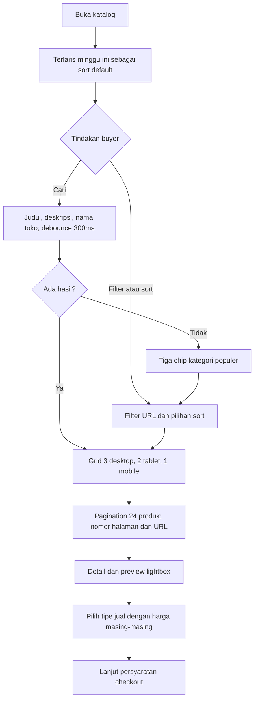

Filter: Kategori, Tipe Jual, Rentang Harga berupa chip preset, Rating Minimum. Sort lain: Terbaru, Termurah, Termahal, Rating tertinggi. Filter dapat dibagikan dan back browser berfungsi. Urutan konten detail tetap mengikuti SPEC-03-06. Produk yang Booked tetap dapat dibeli buyer lain secara paralel; hubungan dengan lock dibahas pada bagian 8.

## 3. Auth, consent dan akses checkout

**Sumber:** SPEC-04-01; SPEC-05-01–03, SPEC-05-07; SPEC-14-03, SPEC-14-05.

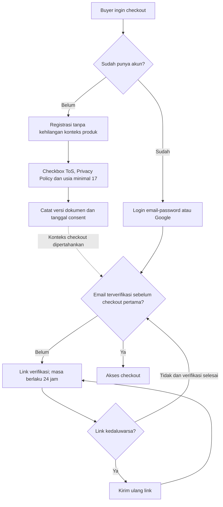

Katalog dapat dilihat tanpa verifikasi email. Ingat saya: session 30 hari; tanpa itu 1 hari; logout manual tersedia. Hubungan verifikasi Google dengan email platform, pembuatan session setelah registrasi, dan pengaitan akun: **[BELUM DIPUTUSKAN - perlu klarifikasi]**.

### 3.1. Pengelolaan akun dan persetujuan

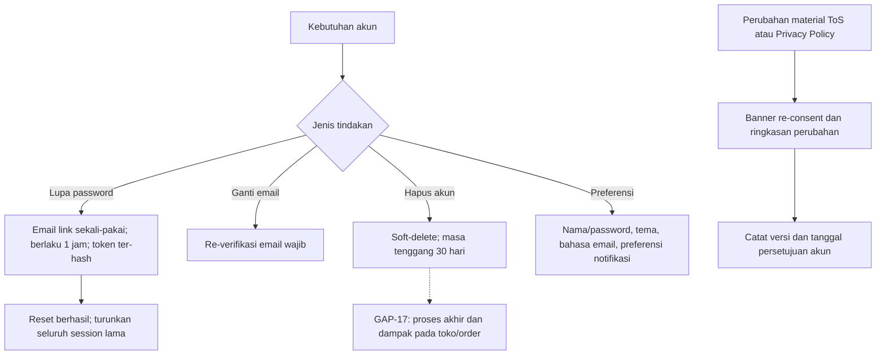

Durasi soft-delete tidak menghapus ketentuan retensi data transaksi. Preferensi tema Dark/Light/System, bahasa email ID/EN dan email promosi mengikuti sumber; tidak ada pemilihan teknologi auth baru.

## 4. Onboarding dan publikasi toko

**Sumber:** SPEC-05-04–05; SPEC-06-01–06; SPEC-02-01; SPEC-04-03.

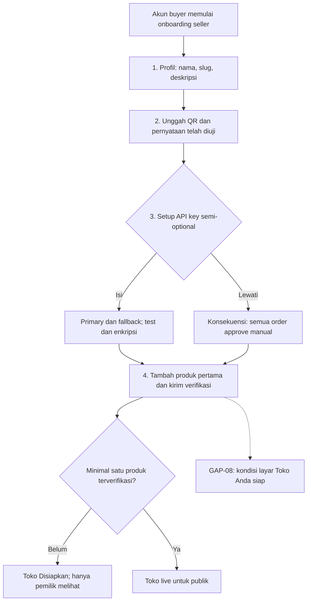

- Semua akun awalnya buyer; kenaikan menjadi seller tidak membutuhkan approval manusia. Kontrol kualitas dilakukan pada verifikasi produk.
- Satu akun satu toko pada fase awal; slug permanen. Nomor WA wajib saat onboarding dan divalidasi format Indonesia; posisi field dalam empat langkah belum dirinci.
- QR: JPG/PNG maksimum 2 MB, preview besar, checkbox pernyataan telah diuji.
- Setiap langkah tersimpan otomatis sebagai draft. Bila terhenti, checklist "Toko Anda X% siap" mengarah ke langkah belum selesai.
- Layar selesai berisi bagikan link toko, kirim produk pertama untuk verifikasi, kenali Komisi & Tagihan, dan status verifikasi realtime. Pengiriman produk muncul juga pada langkah keempat; hubungan keduanya tetap GAP-08.

### 4.1. Branding dan siklus produk seller

**Sumber:** SPEC-02-02–04, SPEC-02-09–10; SPEC-13-01.

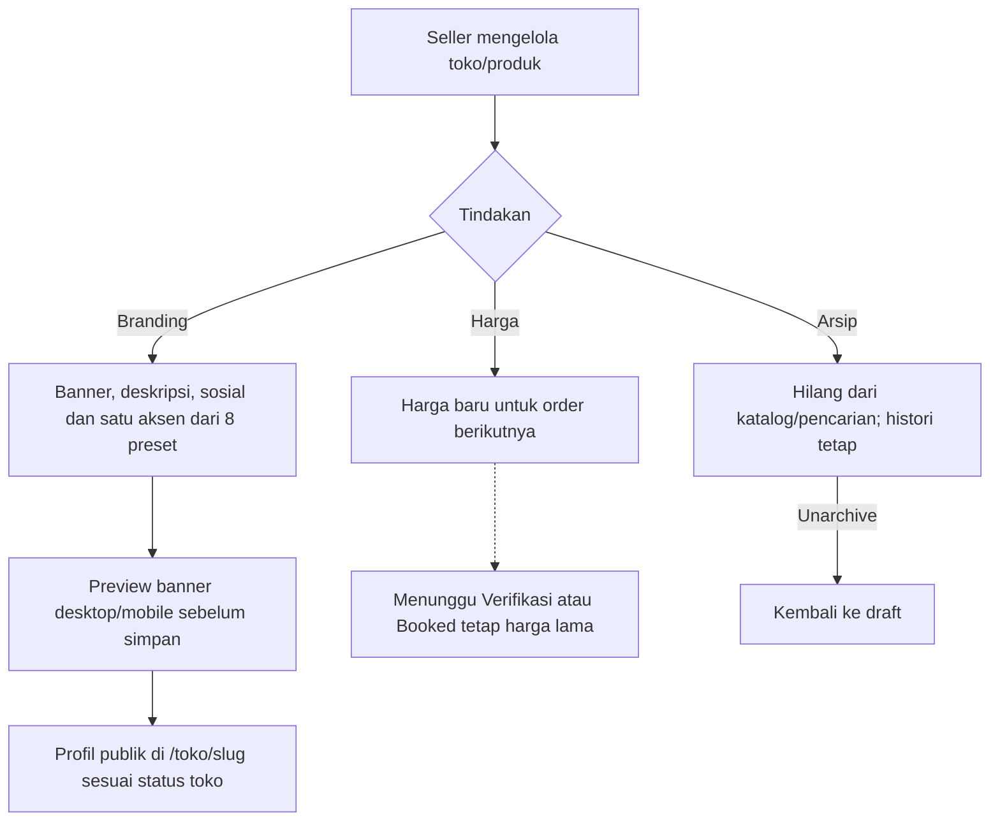

Banner 1600×400 px, JPG/PNG maksimum 2 MB, dikonversi WebP. Deskripsi 500 karakter plain-text dan maksimum tiga link sosial Instagram/X/TikTok. Aksen hanya pada banner, badge dan CTA toko. URL literal profil pada sumber adalah `/toko/{slug}`. Mekanisme publikasi ulang setelah unarchive belum dirinci; tidak digambar sebagai auto-publish.

## 5. Inspeksi dan verifikasi produk

**Sumber:** Konteks Terkunci; SPEC-08-01–06; SPEC-10-01; SPEC-15-07; SPEC-16-09.

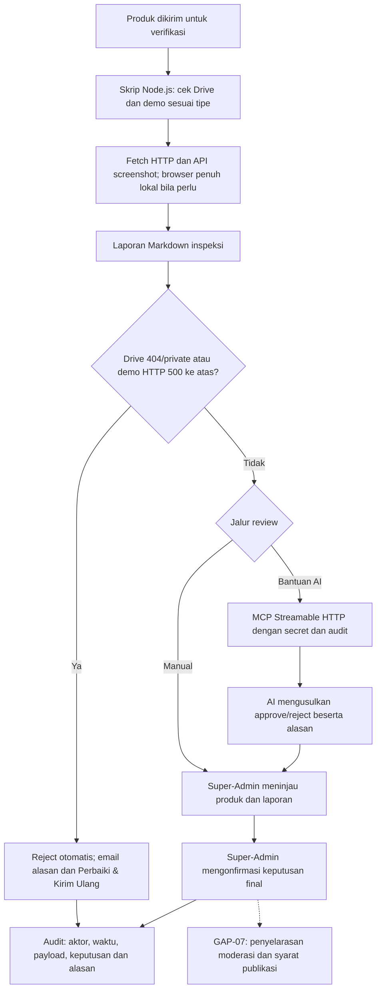

Laporan tetap berisi status Drive (OK/404/private), status HTTP demo dan screenshot desktop, ukuran ZIP, hash file, timestamp. Live demo wajib hanya untuk tipe yang menyertakan template jadi. Tidak lulus kondisi reject otomatis bukan berarti otomatis approved. AI tidak mengeksekusi keputusan final sendiri; reject otomatis teknis tidak menunggu klik Super-Admin.

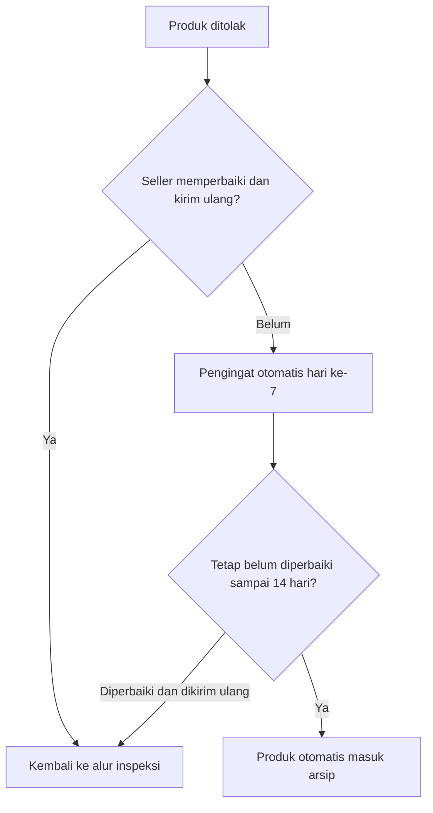

Aturan restart tenggat setelah pengiriman ulang/penolakan ulang tidak ditentukan. Endpoint MCP tidak diekspos publik dan menerima secret token environment; rincian akses jaringan tetap GAP-19.

## 6. Checkout, upload dan jalur verifikasi

**Sumber:** Konteks Terkunci; SPEC-04-01, SPEC-04-04–07; SPEC-06-03; SPEC-07-10.

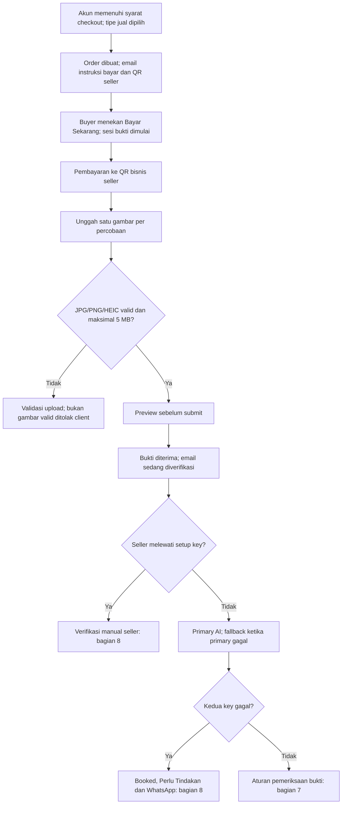

Althentic tidak memegang uang. Timeout, retry, provider/model, definisi key gagal dan penyimpanan bukti sebelum lolos belum diputuskan. Email seller mencakup semua event order. Diagram tidak menetapkan jeda maupun batas kedaluwarsa pembayaran normal.

## 7. Peta keputusan AI Receipt Scanner

**Sumber:** SPEC-07-01–05. Diagram berikut bukan urutan pemeriksaan; setiap aturan tetap berlaku.

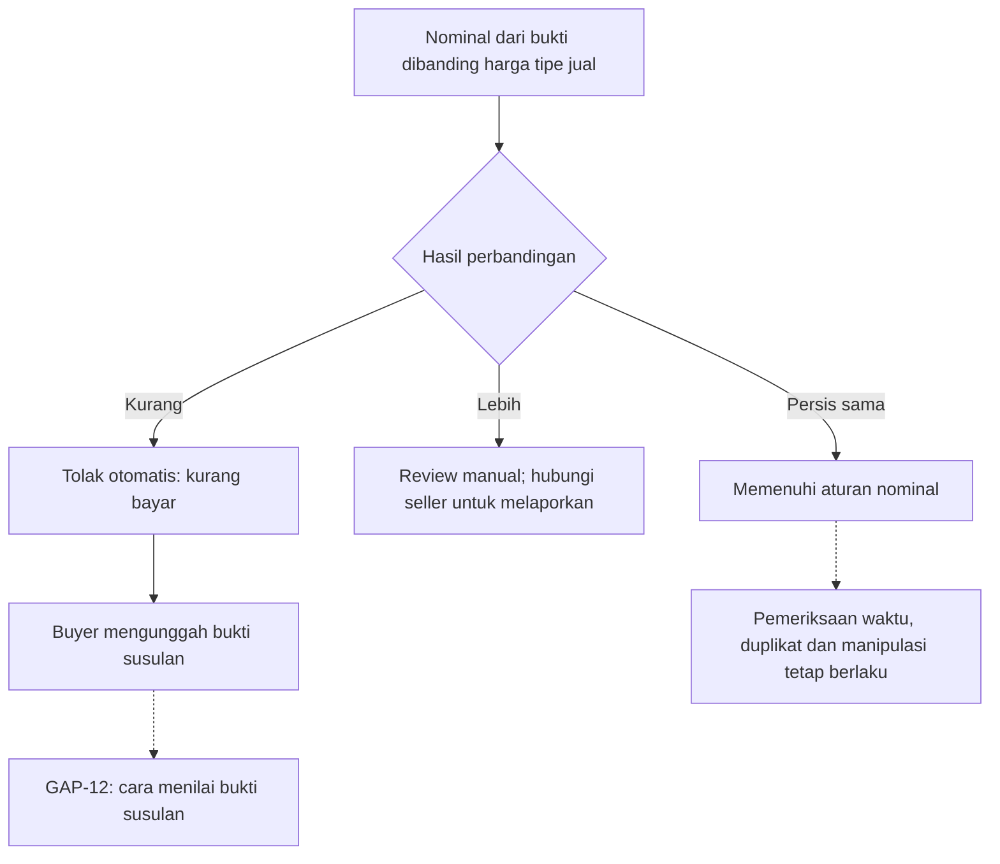

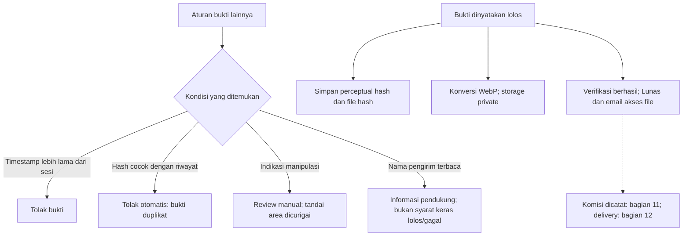

Bukti harus dibuat sejak Bayar Sekarang hingga batas kedaluwarsa sesi. Nama pengirim yang tidak cocok tidak otomatis menjadi alasan gagal. Urutan pemeriksaan, prioritas aturan, hasil ketika lebih dari satu kondisi cocok, dan definisi keberhasilan scanner lengkap: **[BELUM DIPUTUSKAN - perlu klarifikasi]**. Node lolos tidak dihubungkan langsung dari "nominal persis sama" agar tidak meniadakan pemeriksaan lain.

## 8. Jalur manual, Booked dan status order

**Sumber:** SPEC-02-06–07; SPEC-03-07; SPEC-04-02–03, SPEC-04-05, SPEC-04-08; SPEC-07-10.

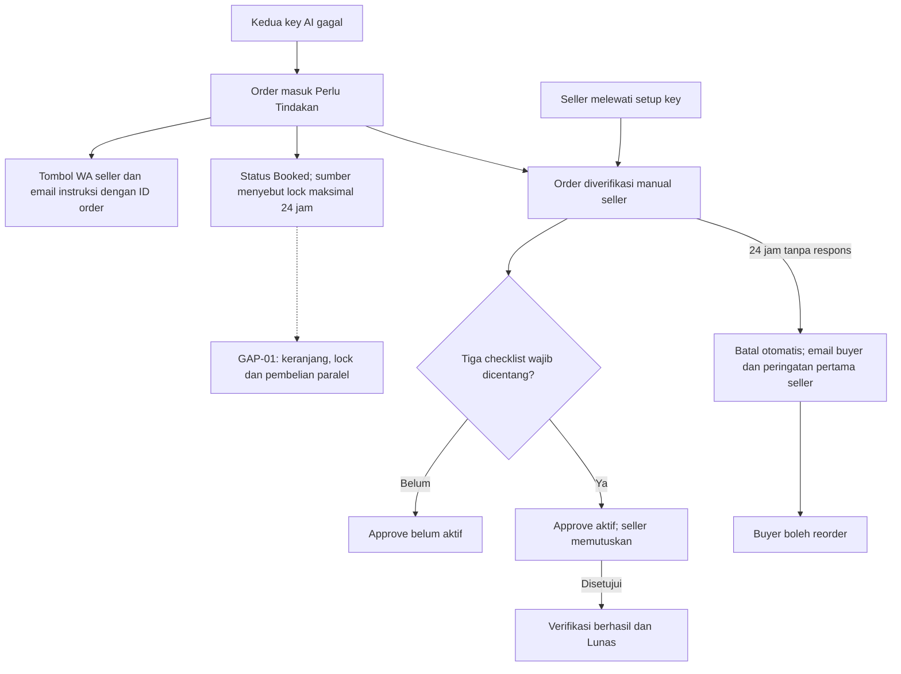

Checklist: nominal sesuai, nama/nomor pengirim terbaca, waktu transfer masuk akal. Keputusan manual untuk kelebihan bayar/dugaan manipulasi mengikuti review manual pada sumber, tetapi daftar aksi, alasan penolakan, dan seluruh transisinya belum dirinci. Titik awal hitung 24 jam juga belum ditentukan.

### 8.1. Booked tidak diselesaikan sebagai asumsi

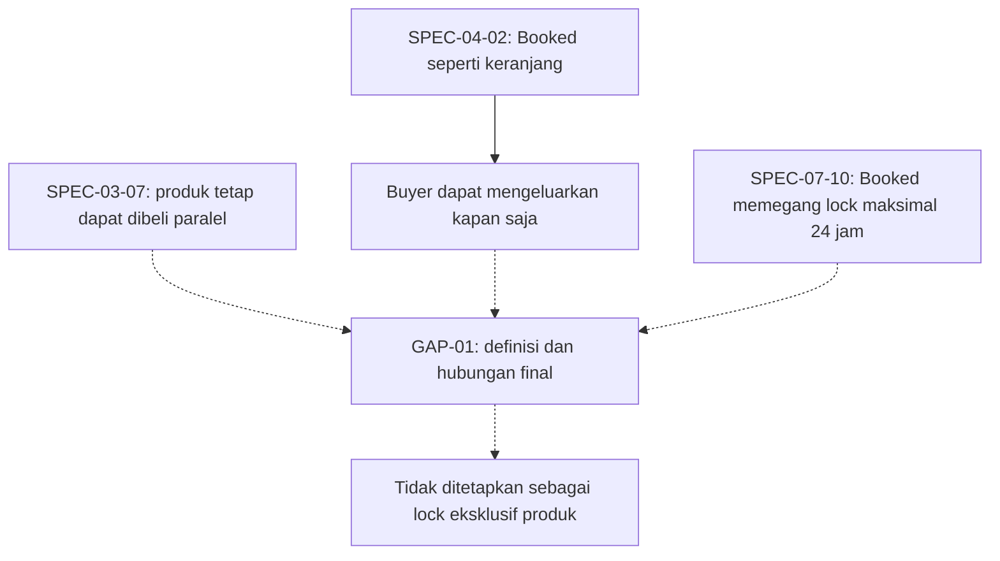

"Tidak ditetapkan" berarti dokumentasi ini tidak memilih interpretasi baru. Keputusan lock asli tetap dipertahankan pada lampiran keputusan.

### 8.2. Pembatalan dan tampilan status

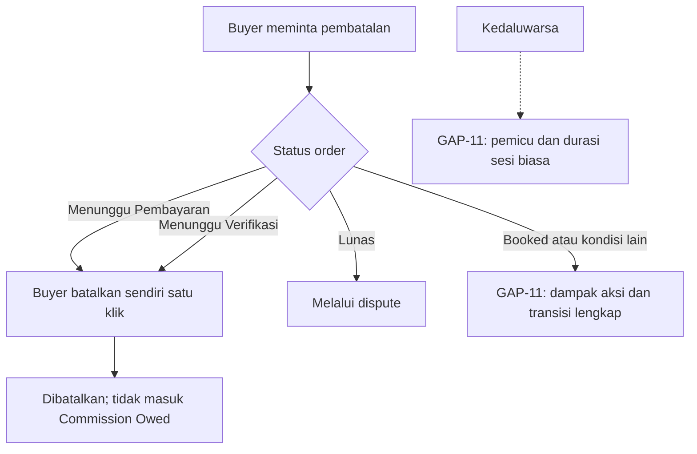

Enam label buyer: Menunggu Pembayaran, Menunggu Verifikasi, Booked, Lunas, Dibatalkan, Kedaluwarsa. UI memakai timeline stepper dengan timestamp perubahan. Diagram tidak menetapkan semua status sebagai tahapan linier atau mengubah Booked menjadi status produk eksklusif.

## 9. Pengelolaan BYOK

**Sumber:** SPEC-07-08–09; SPEC-06-03.

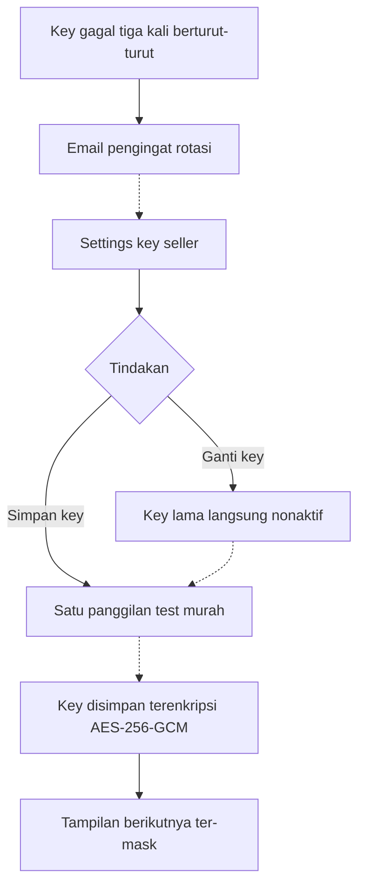

Key enkripsi berasal dari environment Vercel. Perilaku penyimpanan jika test gagal dan hubungan nonaktif key lama dengan kegagalan test pengganti belum dirinci; panah putus-putus tidak menetapkan transaksi atomik atau rollback.

## 10. Notifikasi dan preferensi

**Sumber:** SPEC-04-06–07; SPEC-13-02–03; Konteks Terkunci; SPEC-09-03.

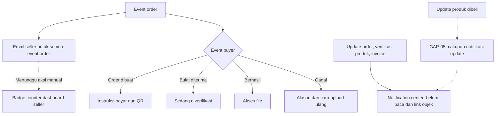

Email lain yang sudah ditentukan tetap berlaku: gagal kedua key, pembatalan manual, reject/perbaikan produk, pengingat invoice/suspend, rotasi key dan error kritis. Pengaturan bahasa email ID/EN serta promosi dapat dimatikan; tidak ada keputusan bahwa mematikan promosi mematikan semua email transaksi. Kanal email memakai Nodemailer. Detail retry/pengiriman/realtime belum diputuskan.

## 11. Komisi dan invoice

**Sumber:** Konteks Terkunci; SPEC-01-05–06; SPEC-09-01–06; SPEC-16-05.

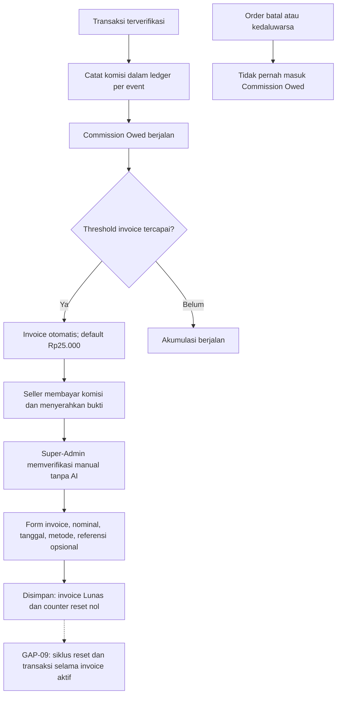

Nominal awal Rp1.000 flat tanpa pengecualian harga; setting bisa diubah untuk transaksi baru, setiap order menyimpan snapshot. Order lama tidak berubah sendiri. Perlakuan prompt gratis, refund, nominal pembayaran invoice kurang/lebih dan titik snapshot untuk order yang belum diverifikasi masih GAP-16.

### 11.1. Pengingat dan konflik waktu suspend

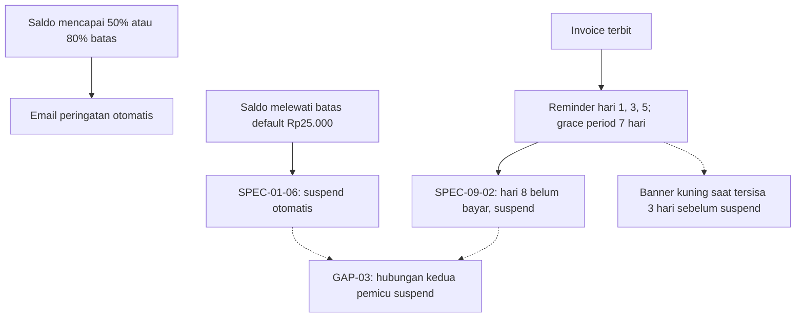

Diagram menyajikan dua keputusan sumber, bukan dua jalur suspend yang sudah disetujui untuk berjalan bersamaan. Reminder email memuat tunggakan, cara bayar dan batas tanggal suspend. Penetapan tanggal final bergantung penyelarasan GAP-03.

### 11.2. Dampak toko suspend

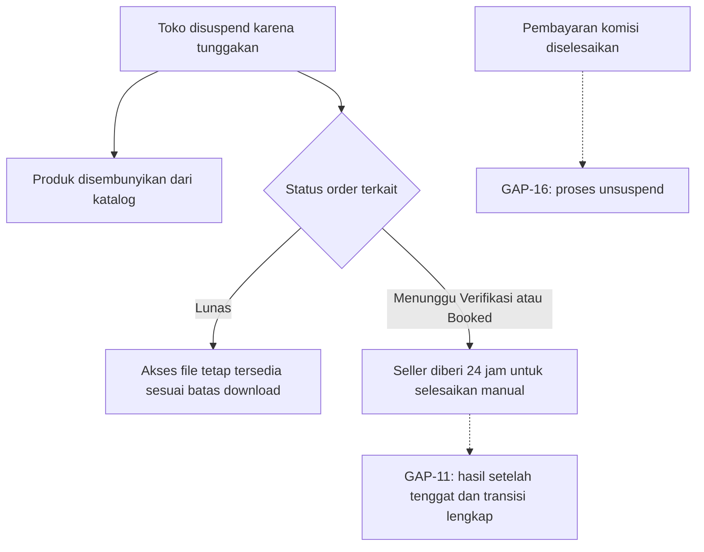

## 12. Delivery, koleksi dan perubahan file

**Sumber:** SPEC-11-01–06; SPEC-04-05; SPEC-15-04.

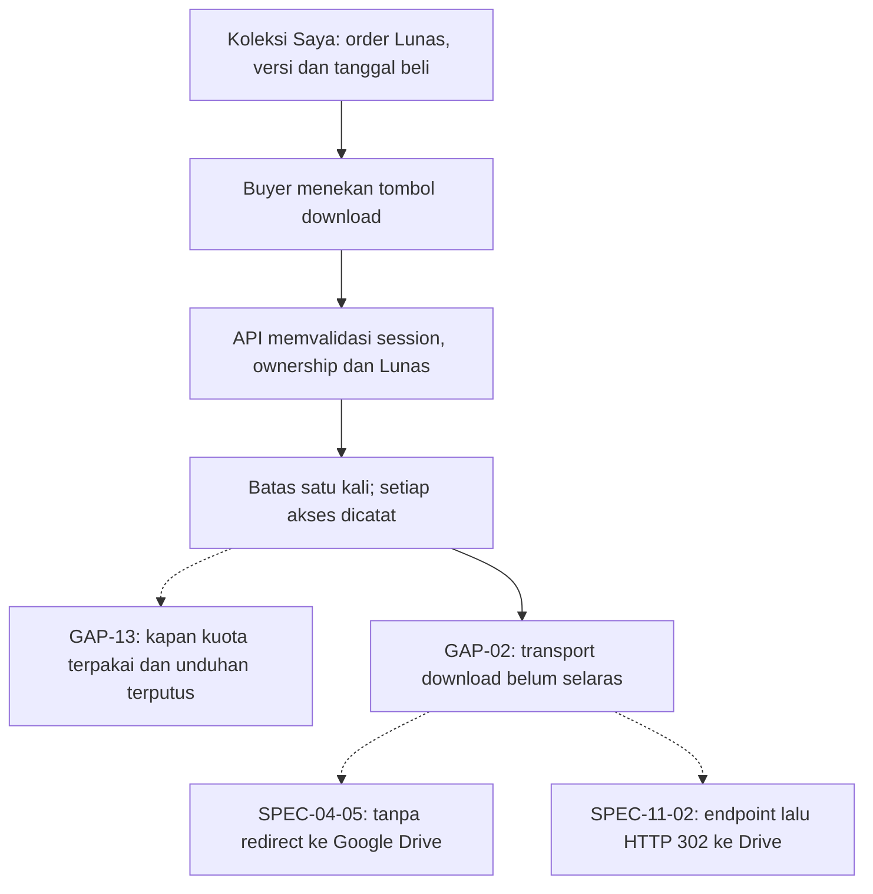

Endpoint literal sumber: `/api/download/[orderId]`. Link Drive tidak ditampilkan mentah. File ZIP di Drive publik, direct-download via `uc?export=download&id=`. Batas satu kali tanpa kecuali/reset tetap berlaku; tidak digambar retry atau unduh ulang yang menambah hak.

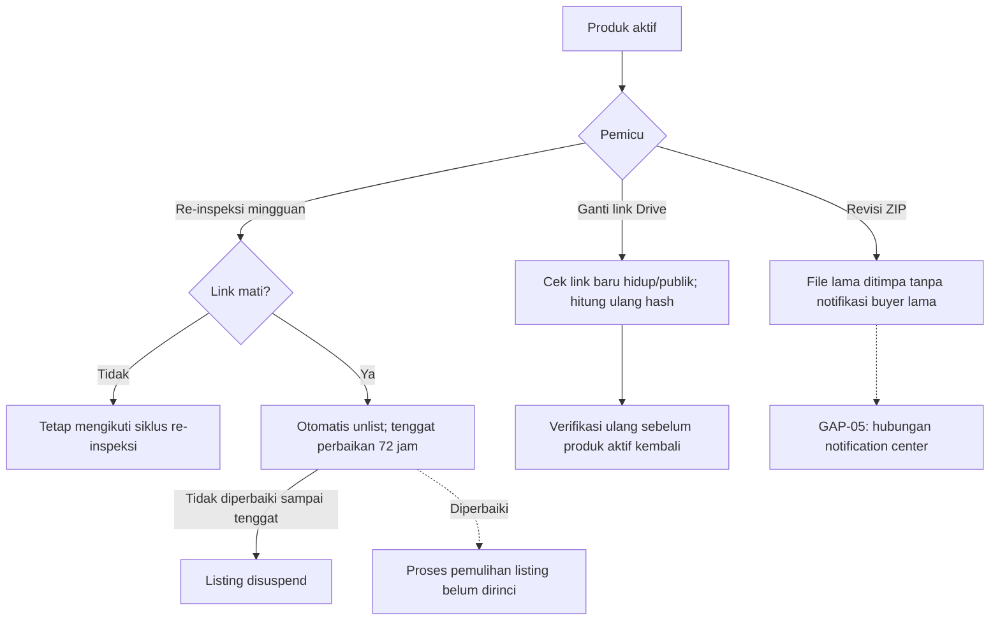

## 13. Review, laporan dan dispute

**Sumber:** Konteks Terkunci; SPEC-10-02–06; SPEC-16-02, SPEC-16-12.

```mermaid
flowchart TD
    A["Buyer ingin review"] --> B{"Punya order Lunas pada produk?"}
    B -->|Tidak| C["Tidak memenuhi syarat review"]
    B -->|Ya| D["Satu review per pembelian: rating dan teks"]
    D --> E{"Tindakan berikutnya"}
    E -->|Buyer edit| F["Boleh dalam 7 hari pertama"]
    E -->|Seller membalas| G["Satu balasan publik; tidak dapat menghapus"]
    E -->|Melanggar aturan| H["Hanya Super-Admin hapus dengan alasan tercatat"]
    I["Sinyal IP/device buyer sama dengan seller"] --> J["Tandai transaksi dan evaluasi self-buy"]
    J --> K["Self-buy tidak dihitung terlaris; rating diflag review"]
```

```mermaid
flowchart TD
    A["Laporan produk"] --> B["Pilih kategori; detail opsional"]
    C["Super-Admin takedown dengan alasan terstruktur"] --> D["Email alasan ke seller"]
    D -->|Seller mengajukan banding| E["Jalur dispute"]
    F["Buyer mengajukan masalah/refund"] --> E
    B -.-> G["Pemetaan laporan ke dispute belum dirinci"]
    E --> H["Inbox Open / Investigating / Resolved"]
    H --> I["Althentic mediator; komunikasi di luar platform"]
    I --> J{"Dasar refund menurut sumber?"}
    J -->|File tak dapat diakses atau isi berbeda drastis| K["Refund didukung; proses manual di luar sistem"]
    J -->|Seller tak merespons 48 jam| K
    J -->|Hanya tidak cocok selera| L["Bukan dasar refund"]
```

Kategori laporan: Konten ilegal, Plagiarisme, Isi tidak sesuai deskripsi, Penipuan pembayaran, Lainnya. Nama status inbox tidak menetapkan semua transisi atau hasil refund otomatis. Format bukti transfer refund dan penutupan dispute belum diputuskan.

```mermaid
flowchart TD
    A["Dispute isi tidak sesuai"] --> B["Seller wajib bukti isi dalam 48 jam"]
    B --> C["Screenshot terstruktur atau walkthrough singkat"]
    C --> D{"Hasil klarifikasi"}
    D -->|Terbukti sesuai| E["Tetap Lunas dengan catatan"]
    D -->|Tidak sesuai| F["Refund manual dan poin sanksi seller"]
    G["Eskalasi sanksi pelanggaran"] --> H["Peringatan email"]
    H --> I["Suspend listing 7 hari"]
    I --> J["Suspend toko sampai pelanggaran beres"]
    J --> K["Banned permanen: email dan pola perangkat diblokir"]
    F -.-> L["Mapping poin ke tingkat sanksi belum diputuskan"]
```

Urutan sanksi berasal dari SPEC-10-07; tidak menentukan berapa poin/pelanggaran yang menaikkan tingkat. Deteksi prompt curian hanya antarproduk katalog Althentic sendiri. Lisensi personal/komersial atas output tidak mengizinkan menjual ulang atau mendistribusikan prompt mentah; pelanggaran berujung banned (SPEC-16-10).

## 14. Prompt Generator

**Sumber:** SPEC-12-01–06.

```mermaid
flowchart TD
    A["Buka Prompt Generator gratis fase awal"] --> B["Tujuh blok inti"]
    B --> C["Kolom vertikal; drag handle untuk reorder"]
    C --> D["Urutan blok menentukan struktur prompt akhir"]
    D --> E{"Pengguna terdaftar?"}
    E -->|Tidak| F["Ekspor terbatas; batas rinci GAP-15"]
    E -->|Ya| G["Ekspor penuh dan integrasi marketplace"]
    G --> H["Markdown terstruktur, plain text, JSON per blok"]
    I["Detail produk Prompt saja"] --> J["Coba di Generator"]
    J --> K{"Pembelian selesai?"}
    K -->|Belum| L["Template read-only; isi tersembunyi"]
    K -->|Ya| M["Batas menyembunyikan isi berakhir; interaksi rinci GAP-15"]
```

Tujuh blok: Peran, Tugas, Konteks, Format Output, Batasan, Contoh, Tone/Gaya. Bentuk ekspor guest, persistensi, schema JSON dan struktur template dari ZIP belum diputuskan. Tidak ada pemanggilan LLM baru yang ditambahkan. Kewajiban WCAG tetap berlaku, termasuk cara aksesibel melakukan reorder; pola kontrolnya belum ditentukan.

## 15. Analytics dan settings

**Sumber:** SPEC-01-01–07; SPEC-02-08; SPEC-16-03, SPEC-16-15.

```mermaid
flowchart TD
    A["Super-Admin membuka Analytics Platform"] --> B["Default 7 hari terakhir"]
    B --> C["Hari ini / 7 / 30 / 90 hari / Custom"]
    C --> D["Metrik dan line chart harian dengan MA 7 hari"]
    D --> E{"Aksi"}
    E -->|Ekspor| F["CSV per tabel transaksi, komisi, seller"]
    F --> G["Semua filter aktif diterapkan"]
    E -->|Pantau seller| H["Rasio aktif/suspend dan konsentrasi top-1"]
    H --> I["Sinyal percepat rekrutmen; tanpa batas seller produktif"]
    J["Seller membuka analytics toko"] --> K["Transaksi, revenue, Commission Owed, produk terlaris"]
    K --> L["Grafik 30 hari dan tabel lima produk teratas"]
```

Empat metrik platform: GMV estimasi, jumlah transaksi terverifikasi, komisi tertagih vs outstanding, rasio seller aktif/suspend. Overview dan tabel seller tetap mengikuti Konteks Terkunci. Metrik keberhasilan utama enam bulan: transaksi terverifikasi per bulan; target angka belum ditentukan.

```mermaid
flowchart TD
    A["Super-Admin Settings"] --> B{"Setting diubah"}
    B -->|Nominal komisi| C["Berlaku transaksi baru; snapshot lama tetap"]
    B -->|Threshold invoice| D["Nilai dapat diubah; default Rp25.000"]
    B -->|Batas tunggakan| E["Default Rp25.000; hubungan suspend GAP-03"]
    B -->|Template WhatsApp| F["Edit textarea dengan placeholder sumber"]
    F --> G["Uji pratinjau merender contoh pesan"]
```

Placeholder sumber: `{nama_buyer}`, `{nama_produk}`, `{jumlah}`, `{slug_toko}`. Pesan fallback juga wajib memuat ID order dan nama produk. Format placeholder untuk ID order belum ditentukan; tidak dibuat token baru secara diam-diam.

## 16. Penyimpanan, retensi dan keamanan

**Sumber:** SPEC-07-06–07; SPEC-14-01–03; SPEC-15-01–04.

```mermaid
flowchart TD
    A["Bukti dinyatakan lolos"] --> B["Konversi WebP"]
    B --> C["Supabase Storage private: receipts/orderId/timestamp.webp"]
    A --> D["Neon: metadata transaksi dan hash"]
    C --> E["Akses melalui signed URL singkat dari API"]
    C --> F["Scanner: hapus file fisik setelah 30 hari"]
    F -.-> G["Metadata transaksi tetap dalam database"]
    H["Privacy Policy: gambar maksimal 90 hari"] -.-> I["GAP-04: penyelarasan retensi"]
    F -.-> I
    J["Data transaksi: akun aktif ditambah 5 tahun"] -.-> K["GAP-06: akses hanya Super-Admin vs fitur buyer/seller"]
```

Path literal storage adalah `receipts/{orderId}/{timestamp}.webp`. Privacy Policy menyebut pemrosesan AI pihak ketiga pilihan seller melalui BYOK, data dikirim langsung ke penyedia, dan Althentic tidak menyimpan salinan hasil proses. Arti salinan hasil proses terhadap metadata scanner masih perlu klarifikasi. Neon menyimpan data relasional; Supabase Storage menyimpan file biner dengan bucket publik/private terpisah. Retensi bukti pembayaran komisi tidak diasumsikan sama dengan bukti buyer.

```mermaid
flowchart TD
    A["Request API Next.js App Router"] --> B["Kontrol wajib: Zod, session dalam route, ownership"]
    B --> C{"Memenuhi kontrol akses/validasi?"}
    C -->|Tidak| D["Respons error tanpa membocorkan stack"]
    C -->|Ya| E["Operasi sesuai otorisasi"]
    F["Login, upload bukti atau submit order"] -.-> G["Upstash Redis REST: sliding window per-IP dan user"]
    G -.-> B
```

Diagram tidak menetapkan urutan middleware, status HTTP, skema payload, nilai limit, atau protokol session. Runtime tetap Next.js App Router full-stack di Vercel; ORM Prisma dan database Neon. Ownership diperiksa di route, bukan hanya mengandalkan middleware.

## 17. Operasional, backup dan insiden

**Sumber:** SPEC-13-05; SPEC-15-05–07; SPEC-16-13–14.

```mermaid
flowchart TD
    A["Operasi platform"] --> B["Structured logging JSON di Vercel Logs"]
    B --> C{"Error kritis?"}
    C -->|Verifikasi gagal massal atau DB gagal| D["Alert email Nodemailer"]
    E["Insiden layanan"] --> F["Update manual /status"]
    F --> G["Kesehatan Neon, Storage dan endpoint kritis"]
    H["Kebocoran key atau bukti transfer"] --> I["Identifikasi"]
    I --> J["Rotasi key"]
    J --> K["Notifikasi terdampak"]
    K --> L["Post-mortem"]
```

```mermaid
flowchart TD
    A["Backup database"] --> B["PITR bawaan Neon"]
    A --> C["GitHub Actions terjadwal bulanan"]
    C --> D["pg_dump otomatis"]
    D --> E["Storage pribadi"]
    B -.-> F["Uji restore berkala"]
    E -.-> F
    G["Single Super-Admin tidak tersedia"] --> H["Risiko platform berhenti total diterima"]
```

Scheduler untuk reminder, retensi dan re-inspeksi selain backup bulanan belum dipilih. Frekuensi uji restore, storage pribadi, SLA/RPO/RTO, retry job/email dan SOP insiden rinci belum diputuskan. Tidak ditambahkan admin pengganti atau keputusan AI otomatis untuk menutup risiko Super-Admin.

## 18. Akuisisi, fase kedua dan legal

**Sumber:** SPEC-16-06–08; SPEC-12-02; SPEC-14-04–06.

```mermaid
flowchart TD
    A["Pemilik platform menjadi seller pertama"] --> B["Rilis 3–5 prompt gratis berkualitas"]
    B --> C["Bagikan di komunitas AI dengan CTA marketplace"]
    C -.-> D["Strategi memperoleh 100 buyer pertama"]
    E["Cari 5–10 pembuat prompt terkurasi"] --> F["Undangan personal dan onboarding dibantu"]
    F --> G["Tawarkan featured listing gratis 30 hari"]
    G -.-> H["GAP-22: hubungan promosi dan fase kedua"]
    I["Monetisasi fase kedua"] --> J["Featured listing 7 hari dengan harga tetap"]
    J -.-> H
```

Generator gratis penuh fase awal; monetisasi nanti melalui template premium. Kota domisili hukum, harga featured listing dan alur produk gratis belum diputuskan. Kewajiban pajak penjualan pada seller, platform menarik komisi layanan dan menyediakan ringkasan transaksi tahunan. Sengketa mengikuti hukum Indonesia, mediasi sebelum litigasi; ToS Indonesia dengan ringkasan Inggris tidak mengikat. Tidak ada tanggal peluncuran fase kedua yang ditambahkan.

## 19. Ketentuan UI lintas seluruh alur

Sembilan ketentuan berikut berasal dari instruksi pengguna, bukan lampiran teknis. Ketentuan ini berlaku di seluruh diagram tanpa menjadikan node proses sebagai desain layar final.

1. Font: Plus Jakarta Sans di seluruh platform.
2. Icon: hanya dari Lucide Icon Library (via CDN). Jangan pernah menggunakan icon emoji, dalam bentuk apa pun.
3. Elemen kustom dengan animasi smooth: custom WebKit scrollbar, custom dropdown, custom checkbox, dan elemen form/UI kustom lainnya - semua dengan transisi/animasi halus, bukan default browser.
4. Accessibility wajib mengikuti standar WCAG di seluruh komponen.
5. Smooth scroll menggunakan Lenis.
6. Responsive design penuh untuk tiga breakpoint: Desktop, Tablet, dan Mobile.
7. Tech stack: Next.js (App Router) sebagai frontend SEKALIGUS backend (API Routes) - satu framework full-stack, bukan React Router terpisah sebagai layer backend. NeonDB Postgres sebagai database, Supabase sebagai storage, Vercel sebagai platform deployment tunggal.
8. Animasi entrance dan exit menggunakan Framer Motion.
9. Gaya visual card (product card, dashboard card, dll) menggunakan Liquid Glass / Glassmorphism style.

Dark/Light/System dan perilaku navbar dari Konteks Terkunci tetap berlaku. Nilai token warna, spacing, radius, breakpoint piksel, parameter motion/Glassmorphism, versi/level WCAG dan pola aksesibel kontrol kustom: **[BELUM DIPUTUSKAN - perlu klarifikasi]**. Tidak digambar alur desain baru dari nilai default komponen.

Landing sembilan section dan dokumentasi dua belas section bergaya GitBook tetap merupakan cakupan sumber; rincian lengkap section tidak tersedia. Halaman 404/500 menggunakan pesan singkat dan pemulihan ke katalog, produk terlaris, halaman sebelumnya; varian 500 menyatakan tim sudah diberi tahu. Halaman status sehari-hari statis dan diperbarui manual saat insiden.

## 20. Register titik klarifikasi

| Referensi                | Dampak pada diagram                                                                                        |
| ------------------------ | ---------------------------------------------------------------------------------------------------------- |
| GAP-01                   | Booked sebagai keranjang, lock 24 jam dan pembelian paralel tidak disatukan menjadi asumsi lock eksklusif. |
| GAP-02                   | Download tanpa redirect dan HTTP 302 sama-sama dicatat; mekanisme final belum dipilih.                     |
| GAP-03                   | Suspend saat batas terlewati vs hari kedelapan invoice belum diselaraskan.                                 |
| GAP-04                   | Retensi 30 hari dan maksimal 90 hari belum diselaraskan; tidak otomatis diganti.                           |
| GAP-05                   | Update file tanpa notifikasi vs notifikasi update produk dibeli.                                           |
| GAP-06                   | Klausul akses data transaksi hanya Super-Admin vs fitur seller/buyer.                                      |
| GAP-07                   | Review konten ilegal/menyesatkan vs semua prompt link hidup boleh dijual tanpa penilaian kualitas.         |
| GAP-08                   | Pengiriman produk di langkah keempat vs layar selesai meminta pengiriman pertama; toko live/disiapkan.     |
| GAP-09                   | Waktu reset siklus/counter dan transaksi baru saat invoice berjalan.                                       |
| GAP-10–15                | Detail halaman, transisi order, scanner, download, kategori/file per tipe dan generator belum lengkap.     |
| GAP-16–22                | Refund/komisi gratis, akun, legal, scheduler/provider, kontrak implementasi, operasi dan featured listing. |
| GAP-23 dan gap DESIGN.md | Detail token/UI yang belum tersedia; sembilan ketentuan umum tetap sudah diputuskan.                       |

Semua titik di atas berstatus **[BELUM DIPUTUSKAN - perlu klarifikasi]**. Diagram tidak menganggap permintaan lanjut dokumen sebagai jawaban atas gap.

## 21. Konteks Terkunci - teks sumber

- Althentic.Dev adalah marketplace PROMPT serbaguna dan multi-tenant (setiap seller punya toko dengan slug unik). Seller pertama adalah pemilik platform sendiri. Fokus awal menarik buyer.
- Produk berupa file .zip di Google Drive (link publik, direct download via `uc?export=download&id=`). Preview gambar wajib. Kategori Website punya 3 tipe jual (Template Jadi / Prompt saja / Bundle) dengan harga terpisah. Live demo wajib hanya untuk tipe yang menyertakan template jadi.
- Althentic tidak memegang uang. Seller memasang QR bisnisnya sendiri. Komisi Rp1.000 flat per transaksi terverifikasi, dicatat sebagai "Commission Owed", dibayar seller secara threshold-based (invoice muncul otomatis saat mencapai threshold, lalu siklus reset ke nol). Bukti transfer komisi diverifikasi manual oleh Super-Admin tanpa AI. Toko bisa di-suspend jika menunggak.
- Verifikasi pembayaran buyer: AI Receipt Scanner dengan BYOK (Gemini dkk). Primary + Fallback key, semi-optional saat onboarding. Kurang bayar ditolak otomatis dan buyer upload bukti susulan. Jika kedua key gagal, muncul tombol WhatsApp ke seller dan produk berstatus "Booked". Jika seller melewati setup API key, semua order disetujui manual. Bukti yang lolos dikonversi ke .webp sebelum masuk database.
- Verifikasi produk: skrip inspeksi Node.js (cek link Drive, status HTTP live demo, screenshot) menghasilkan laporan Markdown. Super-Admin memverifikasi secara manual ATAU lewat AI via MCP server (Streamable HTTP). Notifikasi email ke Super-Admin lewat Nodemailer.
- Trust & Safety: tombol laporkan produk, rating dan review dari buyer yang sudah membeli, Althentic sebagai mediator.
- Tech stack final: Next.js App Router full-stack di Vercel saja, NeonDB Postgres, Neon + Supabase Storage, Nodemailer.
- Design system: Plus Jakarta Sans, Lucide (tanpa emoji), Lenis smooth scroll, Framer Motion, hero Gradient ASCII (reactbits.dev), Dark/Light/System, navbar desktop auto-hide saat scroll down dan muncul saat scroll up (mobile tidak auto-hide).
- Landing Page (9 section) dan Documentation Page (12 section, gaya GitBook) sudah selesai dibrainstorm.
- Dashboard Super-Admin yang sudah diputuskan: Overview lengkap (metrik ringkas + growth chart + kategori terlaris); single Super-Admin hardcoded; tabel seller (nama toko, slug, jumlah produk, commission owed, status, tanggal join, total transaksi terverifikasi, rating); list verifikasi produk berupa tabel + filter + search + audit trail di tab "Riwayat Verifikasi"; Dispute Resolution berupa inbox sederhana (Open/Investigating/Resolved), komunikasi di luar platform, refund manual di luar sistem.

## 22. Register keputusan sumber lengkap

Seluruh 120 jawaban dicantumkan persis. Register ini menjaga detail nominal, batas waktu, format, field dan pengecualian yang tidak muat dalam label diagram. Pertanyaan asli menjaga konteks fase dan cakupan jawaban. ID mengikuti SPEC.md; bukan status atau nama endpoint baru.

### 22.1. Dashboard Super-Admin - Analytics Platform & Settings

**SPEC-01-01 - Rentang waktu default apa yang ditampilkan saat Super-Admin pertama kali membuka halaman Analytics Platform?**

> "7 hari terakhir" sebagai periode default, dengan tab cepat: Hari ini / 7 hari / 30 hari / 90 hari / Custom.

**SPEC-01-02 - Empat kartu metrik teratas Analytics Platform (di luar Overview yang sudah ada) harus menampilkan apa?**

> GMV estimasi (nilai transaksi terverifikasi), jumlah transaksi terverifikasi, komisi tertagih vs outstanding, dan rasio seller aktif vs suspend - satu layar langsung menjawab "sehat atau tidaknya marketplace".

**SPEC-01-03 - Bagaimana grafik tren transaksi ditampilkan ketika jumlah transaksi harian masih sangat kecil (0–3 transaksi per hari)?**

> Line chart harian tetap ditampilkan, ditambah garis kedua berupa moving average 7 hari sebagai baseline tren.

**SPEC-01-04 - Fitur ekspor data dari Analytics Platform: format apa yang dipakai dan cakupannya bagaimana?**

> Export CSV per-tabel (transaksi, komisi, seller) dengan semua filter aktif diterapkan ke file yang diunduh.

**SPEC-01-05 - Nominal komisi flat saat ini Rp1.000. Apakah nilai komisi boleh diubah dari halaman Settings, dan bagaimana perilakunya terhadap transaksi lama?**

> Field "Nominal komisi per transaksi" bisa diedit dari Settings, hanya berlaku untuk transaksi baru; setiap baris order menyimpan snapshot nominal komisi saat transaksi terjadi sehingga "Commission Owed" lama tidak berubah sendiri.

**SPEC-01-06 - Threshold suspend untuk seller menunggak komisi: berapa nilainya dan perilakunya seperti apa?**

> Setting "Batas tunggakan sebelum suspend" default Rp25.000 (setara 25 transaksi); saat terlewati toko di-suspend otomatis, dengan email peringatan otomatis saat saldo menyentuh 50% dan 80% dari batas.

**SPEC-01-07 - Template pesan WhatsApp fallback (yang muncul saat AI Receipt Scanner gagal total) dikelola bagaimana di Settings?**

> Textarea template di Settings dengan placeholder {nama_buyer}, {nama_produk}, {jumlah}, {slug_toko}, plus tombol "Uji pratinjau" yang merender contoh pesan.

### 22.2. Dashboard Admin/Seller

**SPEC-02-01 - Seller ingin mengubah slug tokonya (misal karena rebranding). Aturan apa yang diterapkan?**

> Slug bersifat permanen dan tidak pernah bisa diubah setelah toko dibuat.

**SPEC-02-02 - Untuk branding toko, seberapa jauh seller boleh mengkustomisasi warna halaman tokonya?**

> Seller memilih 1 warna aksen dari 8 preset terkurasi yang hanya diterapkan pada banner, badge, dan tombol CTA tokonya - tidak menyentuh kerangka UI platform.

**SPEC-02-03 - Spesifikasi upload banner toko seperti apa yang diterapkan?**

> Satu banner 1600x400 px (rasio 4:1), JPG/PNG maksimal 2 MB, dikonversi otomatis ke .webp, dengan preview tampilan desktop dan mobile sebelum disimpan.

**SPEC-02-04 - Deskripsi toko: batas panjang dan strukturnya bagaimana?**

> Deskripsi maksimal 500 karakter plain-text, ditambah field terpisah untuk maksimal 3 link sosial media (Instagram, X, TikTok) yang dirender sebagai ikon resmi.

**SPEC-02-05 - Daftar order di dashboard seller: kolom, urutan, dan filter default apa yang dipakai?**

> Tabel dengan kolom ID order, produk, harga, status (Menunggu Verifikasi / Booked / Lunas / Dibatalkan / Kedaluwarsa), waktu relatif ("2 jam lalu"); filter default "Menunggu Verifikasi + Booked" agar aksi menunggu selalu di atas.

**SPEC-02-06 - Saat seller menyetujui order secara manual (jalur tanpa API key), konfirmasi apa yang wajib dia lakukan sebelum tombol Approve aktif?**

> Checklist 3 item wajib dicentang: nominal terlihat sesuai, nama/nomor pengirim terbaca di bukti, dan waktu transfer masuk akal dengan rentang order.

**SPEC-02-07 - Berapa lama seller boleh tidak merespons order manual sebelum sistem mengambil tindakan otomatis?**

> 24 jam tanpa respons: order otomatis batal, buyer menerima email penjelasan dan boleh reorder, seller menerima peringatan kinerja pertama.

**SPEC-02-08 - Analytics penjualan toko: metrik utama apa yang ditampilkan di halaman tersebut?**

> Empat kartu: transaksi terverifikasi, revenue kotor, Commission Owed berjalan, dan produk terlaris - dilengkapi grafik 30 hari dan tabel 5 produk teratas.

**SPEC-02-09 - Ketika seller mengarsipkan (archive) sebuah produk, apa persisnya yang terjadi?**

> Produk hilang dari katalog dan pencarian, order dan statistik lama tetap tersedia di dashboard, dan produk bisa di-unarchive kapan saja ke status draft.

**SPEC-02-10 - Seller mengubah harga sebuah produk; bagaimana dampaknya terhadap order yang sedang berjalan?**

> Harga baru hanya berlaku untuk order yang dibuat setelahnya; order berstatus Menunggu Verifikasi atau Booked tetap mengunci harga lama di baris ordernya.

### 22.3. Katalog & Detail Produk

**SPEC-03-01 - Struktur listing katalog utama untuk menampilkan semua produk seperti apa?**

> Grid kartu 3 kolom di desktop (2 tablet, 1 mobile): preview gambar, judul, harga termurah dari tipe jual yang tersedia, badge kategori, rating, dan nama toko.

**SPEC-03-02 - Set filter katalog: filter apa saja yang ada dan bagaimana perilakunya?**

> Filter Kategori, Tipe Jual (Template Jadi / Prompt saja / Bundle), Rentang Harga (chip preset), dan Rating Minimum - semuanya tersimpan sebagai URL query sehingga hasil filter bisa di-share dan tombol back browser berfungsi.

**SPEC-03-03 - Sorting default katalog dan daftar pilihan sort yang ditawarkan?**

> Default "Terlaris minggu ini", dengan opsi: Terbaru, Termurah, Termahal, Rating tertinggi.

**SPEC-03-04 - Perilaku minimum kotak pencarian di katalog seperti apa?**

> Mencari di judul produk, deskripsi, dan nama toko; debounce 300ms; state "tidak ada hasil" menampilkan 3 chip kategori populer sebagai saran.

**SPEC-03-05 - Pagination atau infinite scroll untuk navigasi katalog?**

> Pagination klasik 24 produk per halaman dengan nomor halaman dan URL yang ikut berganti.

**SPEC-03-06 - Urutan blok konten di halaman detail produk disusun bagaimana?**

> Preview besar (klik untuk lightbox) → judul, nama toko, rating → pilihan tipe jual A/B/C dengan harga → deskripsi lengkap → info file (ukuran .zip, isi) → review → produk serupa.

**SPEC-03-07 - Bagaimana tampilan produk yang sedang berstatus "Booked" (ada order menunggu verifikasi) di katalog dan halaman detailnya?**

> Produk tetap bisa dibeli buyer lain secara paralel tanpa antrian.

**SPEC-03-08 - Elemen rating seperti apa yang ditampilkan di kartu katalog?**

> Bintang + jumlah review ringkas, contoh "4.8 (23)" - detail ulasan tetap di halaman detail.

### 22.4. Alur Checkout & Pembayaran

**SPEC-04-01 - Checkout: bolehkah buyer membeli sebagai guest tanpa membuat akun?**

> Wajib punya akun (email + password atau Google) sebelum masuk halaman checkout; registrasi bisa diselesaikan dari halaman produk tanpa kehilangan konteks.

**SPEC-04-02 - Berapa batas waktu status "Booked" / "Menunggu Verifikasi" sebelum order kedaluwarsa dan produk dilepas?**

> (Ketik sendiri) Booked disini seperti "Tambahkan ke keranjang" di Shoopee. jadi, buyer bisa mengeluarkan sendiri produk booked kapan saja dari keranjang.

**SPEC-04-03 - Saat kedua AI key gagal dan buyer diarahkan ke WhatsApp seller: dari mana nomor seller berasal dan bagaimana ditampilkan?**

> Nomor WA diambil dari field wajib saat onboarding seller (divalidasi format Indonesia), dirender sebagai tombol "Hubungi via WhatsApp" dengan pesan template berisi ID order dan nama produk.

**SPEC-04-04 - Spesifikasi upload bukti transfer oleh buyer: format, ukuran, dan validasinya?**

> Satu gambar per percobaan, format JPG/PNG/HEIC maksimal 5 MB, wajib melalui layar preview sebelum submit, ditolak di sisi client jika bukan gambar valid.

**SPEC-04-05 - Set status order yang dilihat buyer: apa saja dan bagaimana divisualisasikan?**

> (Ketik sendiri) Enam status: Menunggu Pembayaran → Menunggu Verifikasi → Booked (jalur manual) → Lunas (file terbuka) → Dibatalkan → Kedaluwarsa, ditampilkan sebagai timeline stepper dengan timestamp tiap perubahan. seperti yang sudah saya bilang, jangan pernah menampilkan link google drive nya. jadi, link tersebut berada didalam button yang mana button tersebut ketika diklik, file .zip nya akan terdownload tanpa redirect ke google drive

**SPEC-04-06 - Notifikasi email ke buyer dikirim di momen-momen apa saja?**

> Empat email: order dibuat (berisi instruksi bayar + QR), bukti diterima dan sedang diverifikasi, verifikasi berhasil (berisi akses file), verifikasi gagal (berisi alasan dan cara upload ulang).

**SPEC-04-07 - Notifikasi ke seller untuk order baru dan aksi manual: kanal dan bentuknya?**

> Email untuk semua event order, ditambah badge counter menonjol di dashboard seller untuk order yang menunggu aksi manual.

**SPEC-04-08 - Kapan buyer boleh membatalkan order yang dia buat?**

> Selama status masih "Menunggu Pembayaran" atau "Menunggu Verifikasi", buyer bisa batalkan sendiri satu klik; setelah Lunas, hanya lewat jalur dispute.

### 22.5. Auth & Akun

**SPEC-05-01 - Metode login utama yang ditawarkan di halaman masuk?**

> Email + password sebagai jalur utama, dengan tombol "Lanjutkan dengan Google" sebagai alternatif yang setara.

**SPEC-05-02 - Verifikasi email: wajib atau tidak, dan di titik apa dipaksa?**

> Wajib verifikasi sebelum checkout pertama, bukan sebelum bisa melihat-lihat katalog; link verifikasi kedaluwarsa dalam 24 jam dan bisa dikirim ulang.

**SPEC-05-03 - Mekanisme lupa password seperti apa yang diimplementasikan?**

> Email berisi link reset sekali-pakai yang kedaluwarsa dalam 1 jam; token disimpan ter-hash di database; setelah reset, semua session lama diturunkan.

**SPEC-05-04 - Apakah satu akun boleh memiliki lebih dari satu toko?**

> Satu akun = satu toko untuk fase awal; kebutuhan multi-toko ditunda sampai ada seller nyata yang memintanya.

**SPEC-05-05 - Bagaimana seorang buyer menjadi seller? Apa mekanisme kenaikan perannya?**

> Semua akun otomatis berperan buyer; menjadi seller dilakukan lewat onboarding khusus (data toko + QR + API key semi-optional) tanpa approval manusia; kontrol kualitas dilakukan di verifikasi produk.

**SPEC-05-06 - Halaman Settings akun minimal mencakup apa saja?**

> Ubah nama, ganti password, ganti email (wajib re-verifikasi), preferensi email notifikasi, dan hapus akun (soft-delete dengan masa tenggang 30 hari).

**SPEC-05-07 - Berapa lama sesi login bertahan sebelum user diminta masuk kembali?**

> 30 hari dengan opsi "Ingat saya di perangkat ini" dicentang; tanpa itu 1 hari; logout manual selalu tersedia.

### 22.6. Onboarding Seller

**SPEC-06-01 - Urutan langkah onboarding seller disusun bagaimana?**

> Empat langkah berurutan: (1) profil toko (nama, slug, deskripsi), (2) unggah QR pembayaran, (3) API key AI semi-optional dengan penjelasan konsekuensi, (4) tambah produk pertama dan kirim verifikasi.

**SPEC-06-02 - Saat seller mengunggah QR pembayaran, validasi apa yang dilakukan sistem?**

> Wajib gambar JPG/PNG maksimal 2 MB dengan preview besar, plus checkbox pernyataan "Saya sudah menguji scan QR ini dan nominalnya masuk ke rekening saya".

**SPEC-06-03 - Bagaimana menyikapi seller yang menekan "Lewati" pada langkah setup API key AI?**

> Lewati diperbolehkan dengan konsekuensi yang ditulis eksplisit di layar ("Semua order harus Anda approve manual"), dan langkah ini bisa diisi belakangan di Settings toko.

**SPEC-06-04 - Kapan tepatnya sebuah toko baru dianggap "live" dan tampil untuk publik?**

> Setelah memiliki minimal 1 produk berstatus terverifikasi (lolos inspeksi); sebelum itu toko berstatus "Disiapkan" yang hanya terlihat oleh pemiliknya.

**SPEC-06-05 - Jika seller berhenti di tengah onboarding (misalnya setelah langkah 2), apa yang terjadi pada datanya?**

> Setiap langkah tersimpan otomatis sebagai draft; dashboard menampilkan checklist "Toko Anda X% siap" dengan tombol langsung ke langkah yang belum selesai.

**SPEC-06-06 - Apa yang seller lihat tepat setelah menyelesaikan seluruh onboarding?**

> Halaman "Toko Anda siap" berisi 3 langkah berikutnya: bagikan link toko, kirim produk pertama untuk verifikasi, dan kenali halaman Komisi & Tagihan - dengan status verifikasi yang terlihat realtime.

### 22.7. AI Receipt Scanner

**SPEC-07-01 - Aturan pencocokan nominal antara bukti transfer dan harga tipe jual yang dipilih: berapa toleransinya?**

> (Ketik sendiri) nominal di bukti harus persis sama; kurang dari itu ditolak otomatis sebagai kurang bayar, lebih dari itu ditandai untuk review manual dan menghubungi seller untuk melaporkan.

**SPEC-07-02 - Toleransi waktu pada bukti transfer: bagaimana timestamp di bukti dicocokkan dengan sesi order?**

> Bukti harus dibuat dalam jendela sesi order: sejak buyer menekan "Bayar Sekarang" hingga batas kedaluwarsa order; timestamp lebih lama dari itu ditolak.

**SPEC-07-03 - Bagaimana nama pengirim di bukti transfer diperlakukan dalam keputusan verifikasi?**

> Nama pengirim dibaca AI dan ditampilkan sebagai informasi pendukung di UI, tapi bukan syarat lolos-gagal yang keras.

**SPEC-07-04 - Bagaimana sistem mendeteksi bukti transfer yang dipakai ulang untuk order berbeda?**

> Setiap bukti yang lolos disimpan perceptual hash + file hash-nya; bukti baru yang hash-nya cocok dengan riwayat ditolak otomatis dengan alasan "bukti duplikat".

**SPEC-07-05 - Bagaimana menangani dugaan bukti transfer yang dimanipulasi (nominal diedit di screenshot)?**

> Dua lapis: AI diminta menilai indikasi manipulasi (font tidak konsisten, artefak edit, metadata), dan cross-check logika nominal-format; hasil "curiga" masuk antrian review manual dengan area yang dicurigai ditandai.

**SPEC-07-06 - Di mana dan bagaimana file bukti .webp disimpan setelah lolos verifikasi?**

> Supabase Storage bucket private dengan path receipts/{orderId}/{timestamp}.webp; akses hanya lewat signed URL berumur pendek yang diterbitkan API.

**SPEC-07-07 - Berapa lama bukti transfer disimpan dan kapan dihapus?**

> (Ketik sendiri) 30 hari untuk kebutuhan dispute; setelah itu job terjadwal menghapus file fisiknya sementara metadata transaksi tetap di database.

**SPEC-07-08 - API key BYOK seller: bagaimana dienkripsi dan divalidasi saat pertama kali disimpan?**

> Dienkripsi at-rest dengan AES-256-GCM memakai key dari environment Vercel, divalidasi dengan satu panggilan test murah saat disimpan, dan hanya pernah ditampilkan ter-mask (mis. AIza...9f2c) setelahnya.

**SPEC-07-09 - Bagaimana mekanisme rotasi (penggantian) API key oleh seller?**

> Seller bisa menekan "Ganti key" kapan saja di Settings toko; key lama langsung nonaktif; jika key gagal 3 kali berturut-turut, sistem mengirim email pengingat untuk rotasi.

**SPEC-07-10 - Saat primary dan fallback key sama-sama gagal (selain tombol WhatsApp ke seller), apa yang sistem lakukan di belakang layar?**

> Order masuk antrian "Perlu Tindakan" di dashboard seller, buyer menerima email berisi instruksi kontak WA beserta ID order, dan status Booked memegang lock produk maksimal 24 jam.

### 22.8. Verifikasi Produk & MCP

**SPEC-08-01 - Struktur laporan Markdown hasil skrip inspeksi Node.js berisi apa saja?**

> Struktur tetap: status link Drive (OK / 404 / private), status HTTP live demo + screenshot desktop, ukuran file .zip, hash file, dan timestamp inspeksi.

**SPEC-08-02 - Kondisi apa yang memicu reject otomatis tanpa perlu review manusia?**

> Link Drive mati (404 atau private) ATAU live demo merespons HTTP 500 ke atas: langsung direject dengan email alasan ke seller dan tombol "Perbaiki & Kirim Ulang".

**SPEC-08-03 - Berapa lama seller boleh memperbaiki produk yang berstatus ditolak?**

> 14 hari sebelum produk otomatis masuk arsip, dengan email pengingat otomatis di hari ke-7.

**SPEC-08-04 - MCP server yang dipakai AI untuk verifikasi: bagaimana otorisasi dan keamanannya?**

> Endpoint MCP hanya menerima request dengan secret token dari environment, tidak diekspos publik, dan setiap pemanggilan tercatat di log audit.

**SPEC-08-05 - Seberapa jauh AI (lewat MCP) boleh bertindak dalam keputusan verifikasi produk?**

> AI boleh membaca laporan inspeksi dan data produk, lalu mengusulkan keputusan (approve/reject beserta alasan); eksekusi final tetap menunggu satu klik konfirmasi Super-Admin.

**SPEC-08-06 - Apa saja yang dicatat di audit trail setiap kali verifikasi produk terjadi?**

> Setiap aksi tercatat: aktor (sistem otomatis / Super-Admin / AI), timestamp, payload ringkas (produk, laporan), dan hasil keputusan beserta alasannya.

### 22.9. Komisi & Penagihan

**SPEC-09-01 - Ketika toko di-suspend karena menunggak komisi, apa persisnya yang terjadi pada produk dan order yang sedang berjalan?**

> Produk disembunyikan dari katalog; order berstatus Lunas tetap bisa mengakses filenya; order Menunggu Verifikasi/Booked diberi tenggat 24 jam untuk diselesaikan manual oleh seller.

**SPEC-09-02 - Berapa grace period yang diberikan sebelum suspend menunggak dieksekusi, dan bagaimana ritmenya?**

> 7 hari setelah invoice terbit: email reminder di hari ke-1, ke-3, dan ke-5; suspend otomatis di hari ke-8 bila belum dibayar.

**SPEC-09-03 - Bentuk reminder penagihan komisi seperti apa yang dikirim ke seller?**

> Email otomatis (Nodemailer) berisi jumlah tunggakan, cara bayar, batas tanggal suspend, ditambah banner kuning di dashboard seller saat tersisa 3 hari sebelum suspend.

**SPEC-09-04 - Berapa nilai threshold invoice komisi (jumlah Commission Owed yang memicu invoice otomatis)?**

> Rp25.000 (setara 25 transaksi terverifikasi), dapat diubah Super-Admin di Settings.

**SPEC-09-05 - Bagaimana transaksi yang dibatalkan atau kedaluwarsa diperlakukan dalam pencatatan komisi?**

> Order batal/kedaluwarsa tidak pernah masuk "Commission Owed"; komisi hanya dicatat saat transaksi terverifikasi, dalam ledger terpisah per event.

**SPEC-09-06 - Ketika Super-Admin memverifikasi bukti pembayaran komisi secara manual, data apa yang dicatat di sistem?**

> Form verifikasi berisi: pilih invoice, nominal diterima, tanggal bayar, metode (transfer/e-wallet), dan referensi opsional; setelah disimpan status invoice menjadi Lunas dan counter reset ke nol.

### 22.10. Trust & Safety

**SPEC-10-01 - Lapisan moderasi apa yang diterapkan pada produk sebelum tampil publik?**

> Dua lapis: verifikasi teknis otomatis (link Drive, live demo) lewat skrip inspeksi, ditambah review singkat Super-Admin atas deskripsi, preview, dan harga untuk menangkap konten ilegal atau menyesatkan.

**SPEC-10-02 - Bagaimana alur takedown produk bekerja dan siapa yang bisa memicunya?**

> Super-Admin bisa takedown kapan saja namun wajib mengisi alasan terstruktur; seller menerima email alasan tersebut dan bisa mengajukan banding lewat jalur dispute.

**SPEC-10-03 - Tombol laporkan produk: kategori laporan apa yang dipilih pelapor?**

> Lima kategori tetap: Konten ilegal, Plagiarisme, Isi tidak sesuai deskripsi, Penipuan pembayaran, Lainnya - plus field detail opsional.

**SPEC-10-04 - Kebijakan refund (yang diproses manual Super-Admin sebagai mediator): kapan buyer dianggap layak didukung?**

> Refund didukung bila: file tidak bisa diakses, isi berbeda drastis dari deskripsi, atau seller tidak merespons 48 jam; "tidak cocok selera" bukan dasar refund.

**SPEC-10-05 - Siapa yang boleh menulis review, dan apa aturan penulisannya?**

> Hanya buyer dengan order Lunas pada produk tersebut, satu review per pembelian, berisi rating + teks, dan boleh diedit sendiri dalam 7 hari pertama.

**SPEC-10-06 - Bisakah seller menghapus review yang merugikan mereka? Bagaimana review yang melanggar aturan ditangani?**

> Seller tidak bisa menghapus review, hanya bisa membalas satu kali secara publik; review yang melanggar (hujatan, doxing, spam) hanya bisa dihapus Super-Admin dengan alasan tercatat.

**SPEC-10-07 - Bagaimana tangga sanksi untuk seller yang melanggar aturan platform?**

> Empat tingkat eskalasi: peringatan email → suspend listing 7 hari → suspend toko sampai pelanggaran beres → banned permanen dengan pemblokiran email dan pola perangkat.

### 22.11. Delivery File

**SPEC-11-01 - Bagaimana platform mendeteksi dan merespons link Google Drive yang mati atau dihapus seller SETELAH produk terjual?**

> Re-inspeksi berkala mingguan untuk semua produk aktif; saat link mati, produk otomatis di-unlist, seller diberi tenggat 72 jam untuk memperbaiki sebelum listing disuspend.

**SPEC-11-02 - Bagaimana link Google Drive dilindungi agar tidak bocor ke orang yang belum membeli?**

> Link Drive tidak pernah tampil mentah; buyer mengakses via endpoint redirect /api/download/[orderId] yang memvalidasi session dan status Lunas, baru 302 ke link Drive; setiap akses tercatat di log.

**SPEC-11-03 - Berapa batas jumlah download file per order oleh buyer?**

> Hanya 1 kali download, tanpa kecuali dan tanpa reset.

**SPEC-11-04 - Ketika seller mengupdate isi produk (.zip revisi), bagaimana buyer lama mendapatkan pembaruan?**

> File lama langsung ditimpa tanpa notifikasi ke buyer yang sudah membeli.

**SPEC-11-05 - Jika seller mengganti link Drive sebuah produk (misalnya pindah akun Drive), mekanisme apa yang berjalan?**

> Penggantian link memicu verifikasi ulang singkat (cek link baru hidup dan publik) sebelum produk aktif kembali; hash file dihitung ulang untuk mendeteksi perubahan isi.

**SPEC-11-06 - Di mana buyer melihat bukti kepemilikan atas semua produk yang pernah dia beli (untuk akses ulang jangka panjang)?**

> Halaman "Koleksi Saya" permanen di akun buyer: semua order Lunas dengan tombol download, info versi, dan tanggal beli.

### 22.12. Prompt Generator (Gaya M3E Canvas)

**SPEC-12-01 - Prompt Generator ditujukan untuk siapa di peluncuran pertamanya?**

> Publik tanpa login untuk mencoba, dengan ekspor terbatas; akun terdaftar membuka ekspor penuh dan integrasi marketplace.

**SPEC-12-02 - Apakah Prompt Generator gratis atau berbayar?**

> Gratis penuh di fase awal sebagai alat akuisisi dan demo kualitas prompt; monetisasi nanti lewat template prompt premium di marketplace.

**SPEC-12-03 - Komponen (blok) apa saja yang tersedia di canvas pembangun prompt?**

> Tujuh blok inti: Peran (Role), Tugas (Task), Konteks, Format Output, Batasan (Constraints), Contoh (Examples), dan Tone/Gaya.

**SPEC-12-04 - Interaksi drag-drop canvas bagaimana diimplementasikan di versi pertama?**

> Kolom vertikal drag-and-reorder dengan drag handle per blok; urutan blok menentukan urutan struktur prompt akhir.

**SPEC-12-05 - Format ekspor prompt terstruktur yang disediakan?**

> Tiga format: Markdown terstruktur, plain text siap-tempel ke chat AI, dan JSON dengan tiap blok sebagai key.

**SPEC-12-06 - Bagaimana Prompt Generator terintegrasi dengan produk di marketplace?**

> Tombol "Coba di Generator" di halaman detail produk tipe "Prompt saja"; struktur prompt terjual tampil sebagai template read-only di canvas, dengan isi tersembunyi sampai pembelian selesai.

### 22.13. Halaman Tambahan

**SPEC-13-01 - Halaman profil publik toko berisi apa saja dan berada di URL seperti apa?**

> URL /toko/{slug} menampilkan branding, warna aksen, deskripsi, ikon sosial media, statistik publik (jumlah produk, rating rata-rata, tahun bergabung), dan grid produknya.

**SPEC-13-02 - Notification center in-app mencakup notifikasi apa saja?**

> Ikon lonceng dengan panel berisi: update order, hasil verifikasi produk, tagihan komisi/invoice, dan update produk yang dibeli - lengkap dengan penanda belum-baca dan link ke objek terkait.

**SPEC-13-03 - Halaman Settings untuk semua user (buyer maupun seller) berisi preferensi apa?**

> Tema tampilan (Dark/Light/System), bahasa email notifikasi (ID/EN), dan preferensi email promosi yang bisa dimatikan.

**SPEC-13-04 - Halaman 404 dan error (500) dirancang seperti apa?**

> Mengikuti bahasa visual landing page: hero Gradient ASCII, pesan singkat, dan tiga tautan pemulihan (katalog, produk terlaris, halaman sebelumnya); varian 500 menampilkan "tim sudah diberi tahu".

**SPEC-13-05 - Apakah platform butuh halaman status (status page) di fase awal?**

> Ya, versi sederhana di /status: kesehatan Neon, Supabase Storage, dan endpoint kritis; diperbarui manual saat insiden ditambah halaman statis sehari-hari.

### 22.14. Legal

**SPEC-14-01 - Bagaimana Privacy Policy menyatakan pemrosesan gambar bukti transfer oleh AI pihak ketiga (Gemini via BYOK seller)?**

> Klausul eksplisit: gambar bukti diproses oleh layanan AI pihak ketiga yang dipilih seller (memakai API key milik seller); data dikirim langsung ke penyedia tersebut; Althentic tidak menyimpan salinan hasil proses; gambar disimpan maksimal 90 hari lalu dihapus.

**SPEC-14-02 - Bagaimana data finansial (QR seller, nominal transaksi, ledger komisi) diperlakukan secara legal?**

> Digolongkan sebagai "data transaksi": disimpan selama akun aktif ditambah 5 tahun mengikuti kebiasaan pembukuan, dengan akses terbatas hanya Super-Admin.

**SPEC-14-03 - Mekanisme persetujuan pengguna atas ToS dan Privacy Policy seperti apa?**

> Checkbox wajib saat pendaftaran + banner re-consent saat ada perubahan material (menampilkan ringkasan perubahan); versi dokumen dan tanggal persetujuan dicatat per akun.

**SPEC-14-04 - Bagaimana posisi platform terhadap kewajiban pajak atas transaksi seller?**

> Dinyatakan eksplisit: Althentic hanya menarik komisi layanan; seluruh kewajiban pajak atas penjualan menjadi tanggung jawab seller; platform menyediakan ringkasan transaksi tahunan untuk membantu pembukuan.

**SPEC-14-05 - Berapa usia minimum pengguna platform dan bagaimana ditegakkan?**

> Minimal 17 tahun, dinyatakan di ToS dan dikonfirmasi lewat checkbox pernyataan usia saat pendaftaran.

**SPEC-14-06 - Hukum dan yurisdiksi mana yang berlaku untuk ToS dan sengketa?**

> Hukum Indonesia dengan domisili hukum di kota domisili pemilik platform; mediasi wajib sebelum litigasi; ToS ditulis dalam bahasa Indonesia dengan ringkasan bahasa Inggris yang tidak mengikat.

### 22.15. Teknis & Infrastruktur

**SPEC-15-01 - Bagaimana pembagian tugas yang disiplin antara Neon (database) dan Supabase Storage (file)?**

> Neon menyimpan semua data relasional (users, products, orders, ledger komisi, metadata bukti); Supabase Storage hanya menyimpan file biner (bukti .webp, banner, preview) dalam bucket publik dan private terpisah.

**SPEC-15-02 - ORM mana yang dipilih untuk berinteraksi dengan Neon Postgres, dan mengapa?**

> Prisma: schema-first, migration tool matang, type generation kuat, dan dokumentasi melimpah - cocok untuk pengembang solo yang harus cepat jalan dengan aman.

**SPEC-15-03 - Strategi rate limiting di lingkungan serverless Vercel yang tidak punya memori bersama?**

> Rate limit berbasis Upstash Redis REST (free tier) dengan sliding window per-IP+user pada endpoint sensitif: login, upload bukti, dan submit order.

**SPEC-15-04 - Lapisan keamanan wajib di setiap API route adalah apa saja?**

> Validasi input dengan Zod di setiap route, cek session di dalam route (tidak percaya middleware semata), otorisasi per-ownership (buyer hanya menyentuh order miliknya), dan error response yang tidak membocorkan stack.

**SPEC-15-05 - Stack logging dan monitoring minimal yang dipakai di fase awal?**

> Structured logging JSON konsisten dilihat lewat Vercel Logs, plus alert email via Nodemailer untuk error kritis (verifikasi gagal massal, koneksi DB gagal).

**SPEC-15-06 - Strategi backup untuk database Neon seperti apa?**

> Mengandalkan point-in-time restore bawaan Neon, ditambah pg_dump otomatis bulanan via GitHub Actions terjadwal yang disimpan di storage pribadi - dengan uji restore berkala.

**SPEC-15-07 - Inspeksi Puppeteer untuk verifikasi produk kena batas serverless Vercel; bagaimana solusinya?**

> Jangan jalankan browser penuh di Vercel: cek status link via fetch HTTP biasa, screenshot via API screenshot free-tier, dan bila perlu browser penuh, jalankan skrip dari mesin lokal Super-Admin lalu unggah laporannya.

### 22.16. Pertanyaan Gap - Celah yang Belum Terpikirkan

**SPEC-16-01 - Seller bisa menjual prompt yang dicuri dari marketplace lain. Bagaimana lapisan deteksi pertamanya?**

> Deteksi otomatis antar produk di katalog Althentic sendiri saja.

**SPEC-16-02 - Buyer komplain "isi prompt di dalam .zip tidak sesuai janji" padahal deskripsi terlihat benar. Bagaimana proses klarifikasinya?**

> Seller wajib menunjukkan bukti isi (screenshot terstruktur atau walkthrough singkat) dalam 48 jam lewat dispute; terbukti sesuai: tetap lunas dengan catatan; tidak sesuai: refund manual plus poin sanksi seller.

**SPEC-16-03 - Bagaimana jika satu seller menguasai 80% katalog (risiko monokultur)? Apa sikap platform?**

> Tambahkan metrik "konsentrasi top-1 seller" di dashboard Super-Admin sebagai sinyal untuk mempercepat rekrutmen seller, tanpa pembatasan eksplisit terhadap seller produktif.

**SPEC-16-04 - Platform bergantung pada Google Drive (delivery) dan Gemini (verifikasi). Apa persiapan bila harga atau kebijakan keduanya berubah drastis?**

> Dokumentasikan abstraksi: modul delivery dan modul AI scanner masing-masing punya satu interface tunggal sehingga bisa ganti provider dengan menyentuh 1–2 file saja; digunakan saat benar-benar dibutuhkan.

**SPEC-16-05 - Bagaimana nasib komisi Rp1.000 flat ketika ada seller menjual produk super murah, misalnya Rp3.000?**

> Tetap Rp1.000 flat tanpa pengecualian harga.

**SPEC-16-06 - Selain komisi, monetisasi mana yang paling layak diprioritaskan di fase kedua?**

> Featured listing: produk tampil di posisi teratas katalog/beranda selama 7 hari dengan harga tetap.

**SPEC-16-07 - Bagaimana strategi mendapatkan 10 seller pertama (di luar pemilik platform sendiri)?**

> Undangan personal terkurasi: cari 5–10 pembuat prompt yang karyanya sudah bagus di komunitas (X, Discord AI Indonesia), tawarkan onboarding dibantu langsung dan featured listing gratis 30 hari.

**SPEC-16-08 - Bagaimana strategi mendapatkan 100 buyer pertama?**

> Konten dulu: rilis 3–5 prompt gratis berkualitas tinggi dari toko pemilik, dibagikan di komunitas AI dengan CTA menuju marketplace.

**SPEC-16-09 - Bagaimana kualitas isi prompt di katalog dijaga (bukan cuma link yang hidup)?**

> Tidak ada penilaian kualitas; semua prompt yang link-nya hidup boleh dijual.

**SPEC-16-10 - Apa batasan lisensi buyer atas prompt yang dibeli? Bolehkah dijual ulang di Althentic?**

> ToS menyatakan: lisensi penggunaan personal dan komersial atas output, dilarang menjual ulang atau mendistribusikan file prompt mentah; pelanggaran berujung banned.

**SPEC-16-11 - Terhadap kompetitor seperti PromptBase, diferensiasi mana yang dipertahankan mati-matian?**

> Lokalisasi penuh: pembayaran QR lokal tanpa kartu internasional, kurasi dan komunitas berbahasa Indonesia, harga Rupiah.

**SPEC-16-12 - Bagaimana mendeteksi seller yang membeli produknya sendiri (akun kedua) untuk memanipulasi rating dan metrik terlaris?**

> Verifikasi transaksi mencocokkan sinyal: akun buyer dengan IP/device fingerprint yang sama dengan seller ditandai; transaksi self-buy tidak dihitung ke metrik terlaris dan ratingnya diflag untuk review.

**SPEC-16-13 - Jika satu-satunya Super-Admin sakit atau tidak bisa mengakses internet selama 2 minggu, apa yang terjadi pada operasi kritis?**

> Terima risiko platform berhenti total selama itu.

**SPEC-16-14 - Data apa yang paling fatal jika bocor, dan sejauh apa rencana respons insidennya?**

> Kandidat paling fatal: API key seller (menyalahgunakan kuota AI atas nama mereka) dan bukti transfer (data finansial); siapkan satu halaman SOP insiden: identifikasi → rotasi key → notifikasi terdampak → post-mortem.

**SPEC-16-15 - Satu metrik utama apa yang menentukan platform dinyatakan berhasil di 6 bulan pertama?**

> Jumlah transaksi terverifikasi per bulan.

## 23. Status dan langkah berikutnya

Dokumen alur kerja ini disusun setelah PRD.md sesuai perubahan urutan oleh pengguna. Diagram adalah dokumentasi, bukan bukti implementasi atau pengujian aplikasi. **PROMPT.md** sudah disusun sebagai prompt eksekusi terpisah (dikirim sebagai code box, bukan file), termasuk resolusi untuk seluruh gap yang terdaftar pada dokumen ini - lihat riwayat percakapan untuk versi finalnya.
